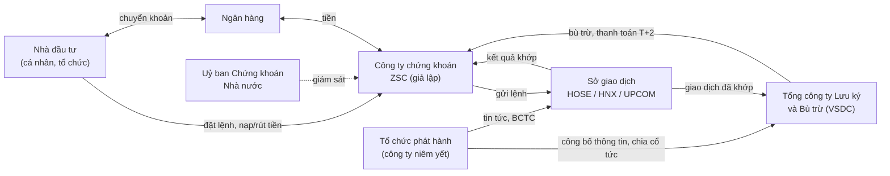
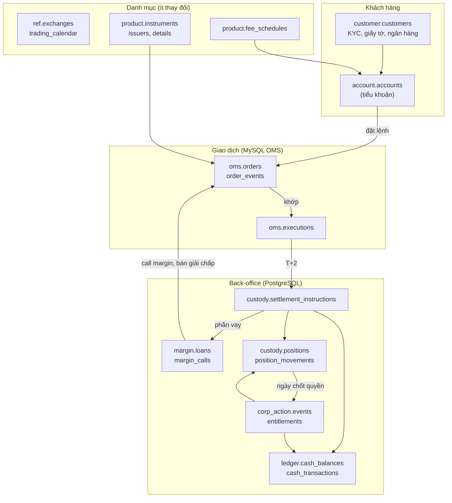

# 1. Toàn cảnh: công ty chứng khoán làm gì?

## 1.1. Hình dung đơn giản

Bạn muốn mua cổ phiếu của một công ty niêm yết. Bạn **không thể** tự đến sở giao dịch chứng khoán để mua. Chỉ các **công ty chứng khoán (CTCK)** là thành viên của sở mới được gửi lệnh vào sàn.

Vì vậy CTCK đóng vai trò giống "ngân hàng + cửa hàng" cho chứng khoán:

- **Giữ tiền** của nhà đầu tư (NĐT) để họ mua chứng khoán.
- **Giữ chứng khoán** của NĐT (thông qua lưu ký).
- **Nhận lệnh** mua/bán từ app, web, hoặc qua nhân viên môi giới, rồi chuyển lên sàn.
- **Cho vay** để NĐT mua nhiều hơn số tiền họ có (margin).
- **Chăm sóc, tư vấn, giám sát** khách hàng.

CTCK kiếm tiền chủ yếu từ **phí môi giới** (thu trên mỗi giao dịch khớp) và **lãi cho vay margin**. Dataset này mô phỏng đúng hai mảng đó. Các mảng khác của CTCK thật như tự doanh, bảo lãnh phát hành, tư vấn doanh nghiệp không nằm trong phạm vi.

## 1.2. Các bên tham gia thị trường

| Bên | Vai trò | Xuất hiện trong dataset ở đâu |
|---|---|---|
| Nhà đầu tư | Người mua bán chứng khoán | `customer.customers` và các bảng con |
| CTCK (ZSC) | Nhận lệnh, giữ tiền, cho vay | Toàn bộ hai DB. Nhân sự ở `ref.employees`, chi nhánh ở `ref.branches` |
| Sở giao dịch | Khớp lệnh mua với lệnh bán, công bố giá | `ref.exchanges`, `ref.trading_calendar`, `product.eod_prices`, topic Kafka `marketdata.ticks`, cột `oms.executions.exchange_exec_no` |
| VSDC | Lưu ký tập trung, bù trừ và thanh toán | Không có bảng riêng. Dấu vết: `customers.custody_code` (số lưu ký), `foreign_trading_code`, `custody.settlement_instructions` |
| Ngân hàng | Nơi khách nạp/rút tiền | `customer.bank_accounts`, `ledger.cash_transactions` với `channel = 'BANK_TRANSFER'` |
| Tổ chức phát hành | Công ty phát hành cổ phiếu, trái phiếu, quỹ | `product.issuers`, `product.financial_statements`, `content.disclosures`, `corp_action.events` |
| Cơ quan quản lý | Ban hành quy định, giám sát | Gián tiếp: quy tắc AML ở `compliance.*`, biên độ giá, room ngoại |

Một điểm hay gây nhầm: **sở giao dịch chỉ khớp lệnh**, còn việc tiền và chứng khoán thực sự đổi chủ do **VSDC** thực hiện sau đó 2 ngày làm việc (T+2). Đây là lý do có cả bảng `oms.executions` (khớp) lẫn `custody.settlement_instructions` (thanh toán).

## 1.3. Bên trong CTCK: front, middle, back office

| Khối | Ai làm | Việc chính | Schema |
|---|---|---|---|
| **Front office** (tiếp xúc khách) | Môi giới (`BROKER`), quản lý quan hệ khách hàng (`RELATIONSHIP_MANAGER`), chăm sóc khách hàng (`SUPPORT`) | Mở tài khoản, nhận lệnh, tư vấn, xử lý khiếu nại | `customer`, `account`, `oms`, `crm` |
| **Middle office** (kiểm soát) | Quản trị rủi ro, tuân thủ (`COMPLIANCE`), phân tích (`ANALYST`) | Duyệt danh mục cho vay, call margin, giám sát rửa tiền, viết báo cáo phân tích | `margin`, `compliance`, `content.research_reports` |
| **Back office** (vận hành) | Vận hành (`OPERATIONS`) | Thanh toán bù trừ, lưu ký, kế toán tiền, thực hiện quyền | `ledger`, `custody`, `corp_action` |

Vai trò nhân viên nằm ở cột `ref.employees.role`. Khi đọc một bảng, hãy tự hỏi "khối nào sở hữu dữ liệu này?". Câu trả lời thường giải thích vì sao bảng được thiết kế như vậy.

## 1.4. Vì sao dữ liệu chia làm hai database?

CTCK thật thường tách hệ thống thành hai khối:

| | **OMS** (Order Management System) | **Core / back-office** |
|---|---|---|
| DB trong lab | MySQL, database `oms` | PostgreSQL, 11 schema |
| Đặc điểm | Ghi rất nhiều trong giờ giao dịch, cần độ trễ thấp | Ghi ít hơn nhưng phải chính xác tuyệt đối về tiền |
| Dữ liệu | Lệnh, sự kiện lệnh, khớp lệnh, phiên đăng nhập, danh mục theo dõi | Khách hàng, tài khoản, tiền, chứng khoán, vay, quyền, CSKH, AML |

Hai DB **không có khoá ngoại với nhau**. `oms.orders.account_id` chỉ là tham chiếu logic tới `account.accounts.account_id`. OMS còn cố ý lưu trùng `symbol`, `exchange_code`, `customer_id` để khỏi phải gọi sang core khi đang xử lý lệnh.

Với người làm dữ liệu, hệ quả là: câu hỏi kiểu "phí môi giới theo chi nhánh" cần `oms.executions` (MySQL) join với `customer.customers` và `ref.branches` (PostgreSQL). Không DB nào tự trả lời được. Phải join ở tầng stream (Kafka Streams, Flink) hoặc lakehouse/Trino.

## 1.5. Bản đồ nghiệp vụ

Hình dưới là "dòng chảy" chính. Mỗi hộp là một nhóm bảng, mũi tên là quan hệ nghiệp vụ.

| Schema | Trả lời câu hỏi nghiệp vụ nào? |
|---|---|
| `ref` | Sàn nào, biên độ bao nhiêu, hôm nay có giao dịch không, ngành gì, nhân viên nào ở chi nhánh nào? |
| `product` | Mã này là gì, của công ty nào, giá hôm qua thế nào, phí bao nhiêu? |
| `customer` | Khách là ai, giấy tờ gì, khẩu vị rủi ro ra sao, liên kết ngân hàng nào? |
| `account` | Khách có những tiểu khoản nào, áp dụng gói phí nào? |
| `oms` | Khách đặt lệnh gì, lệnh khớp chưa, đăng nhập từ thiết bị nào? |
| `ledger` | Khách còn bao nhiêu tiền, tiền đi đâu về đâu? |
| `custody` | Khách đang giữ bao nhiêu cổ phiếu, bao nhiêu đang chờ về? |
| `margin` | Khách nợ bao nhiêu, có bị call không? |
| `corp_action` | Khách được nhận cổ tức bao nhiêu? |
| `crm` | Khách phàn nàn gì, có hài lòng không? |
| `compliance` | Khách có dấu hiệu rửa tiền, thao túng không? |
| `content` | Tin tức, công bố thông tin, báo cáo phân tích, tài liệu sản phẩm |

## 1.6. Khái niệm quan trọng nhất: trạng thái hiện tại và nhật ký

Hệ thống tài chính luôn có hai cách nhìn cùng một dữ liệu:

- **Trạng thái hiện tại (snapshot):** "bây giờ tài khoản có bao nhiêu tiền?". Một dòng cho mỗi đối tượng, bị `UPDATE` liên tục.
- **Nhật ký (journal):** "tiền đã thay đổi những lần nào?". Chỉ `INSERT`, không bao giờ sửa hay xoá.

Dataset có ba cặp như vậy:

| Đối tượng | Snapshot (bị update) | Journal (chỉ insert) |
|---|---|---|
| Tiền | `ledger.cash_balances` | `ledger.cash_transactions` |
| Chứng khoán | `custody.positions` | `custody.position_movements` |
| Lệnh | `oms.orders` | `oms.order_events` |

Với streaming, đây chính là cặp **KTable** (changelog, giữ giá trị mới nhất theo key) và **KStream** (dòng sự kiện). Bạn sẽ gặp lại cặp này ở mọi bài sau.

Lưu ý: snapshot và journal **không phải lúc nào cũng khớp tức thời**. Ví dụ khi lệnh mua vừa khớp, `cash_balances` thay đổi ngay nhưng `cash_transactions` phải đến T+2 mới có dòng. [Bài 5](05-thanh-toan-tien-va-chung-khoan.md) giải thích chi tiết.

---

Tiếp theo: [2. Sản phẩm và thị trường →](02-san-pham-va-thi-truong.md)
