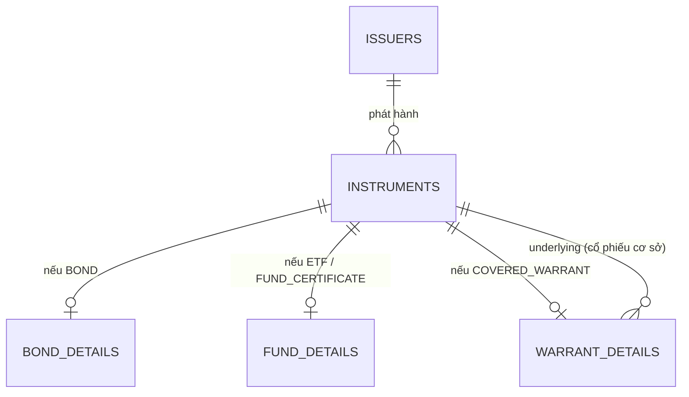

# 2. Sản phẩm và thị trường

Schema: `ref`, `product`. Đây là dữ liệu **danh mục**: ít thay đổi, nhưng mọi bảng giao dịch đều tham chiếu tới.

## 2.1. Năm loại chứng khoán trong dataset

Mọi thứ có thể mua bán đều nằm trong `product.instruments`, phân biệt bằng `instrument_type`.

| `instrument_type` | Tên tiếng Việt | Hiểu đơn giản | Bảng chi tiết |
|---|---|---|---|
| `STOCK` | Cổ phiếu | Một phần quyền sở hữu công ty. Mệnh giá 10.000đ/cổ phiếu | (không có) |
| `ETF` | Chứng chỉ quỹ ETF | Một "rổ" cổ phiếu đóng gói lại, mua bán trên sàn như cổ phiếu | `fund_details` |
| `COVERED_WARRANT` | Chứng quyền có bảo đảm (CW) | Quyền được mua một cổ phiếu cơ sở với giá định trước, trong thời hạn nhất định. Do CTCK phát hành | `warrant_details` |
| `BOND` | Trái phiếu | Giấy nợ. Người mua cho tổ chức phát hành vay, nhận lãi định kỳ (coupon) và nhận lại gốc khi đáo hạn | `bond_details` |
| `FUND_CERTIFICATE` | Chứng chỉ quỹ mở | Góp vốn vào quỹ do công ty quản lý quỹ điều hành. **Không** giao dịch trên sàn, mua/bán theo giá NAV | `fund_details` |

### Mô hình supertype / subtype

`product.instruments` chứa các cột chung (mã, sàn, tổ chức phát hành, trạng thái). Mỗi loại có thuộc tính riêng nằm ở bảng con, quan hệ **1-1** qua `instrument_id`:

Một vài thuộc tính đáng chú ý:

- **Chứng quyền:** `conversion_ratio = 4` nghĩa là cần 4 chứng quyền để quy đổi ra 1 cổ phiếu cơ sở. `issuer_id` của chứng quyền là **CTCK phát hành**, không phải công ty của cổ phiếu cơ sở.
- **Trái phiếu:** `coupon_frequency` là số lần trả lãi mỗi năm. Trái phiếu doanh nghiệp riêng lẻ chỉ dành cho **nhà đầu tư chuyên nghiệp** (`kyc_profiles.is_professional_investor`).
- **Quỹ mở:** `exchange_code` là `NULL` vì không lên sàn. Giá là NAV/đơn vị, nằm ở `product.fund_navs`, công bố hằng ngày hoặc hằng tuần (`nav_frequency`).

`instruments.status` cho biết vòng đời: `ACTIVE` → `SUSPENDED` (tạm ngừng) → `DELISTED` (huỷ niêm yết), hoặc `MATURED` (trái phiếu, chứng quyền đáo hạn).

## 2.2. Tổ chức phát hành và ngành

- `product.issuers`: công ty niêm yết, tổ chức phát hành trái phiếu, công ty quản lý quỹ. Có `charter_capital` (vốn điều lệ) và `tax_code`.
- `ref.sectors`: cây phân ngành kiểu ICB. `level = 1` là ngành lớn (Tài chính, Bất động sản…), `level = 2` là ngành con (Ngân hàng, Chứng khoán…). Cột `parent_sector_code` tạo cấu trúc cây.
- `product.financial_statements`: số liệu báo cáo tài chính (BCTC). `fiscal_quarter = 0` là **báo cáo năm**, 1–4 là báo cáo quý.

Ba mã "neo" mà bộ câu hỏi text2sql dùng: `ZTC` (Phần mềm), `ZAB` (Ngân hàng), `ZRE` (Bất động sản dân cư).

## 2.3. Ba sàn giao dịch

| `exchange_code` | Tên | Biên độ (`price_band_pct`) | Đặc điểm |
|---|---|---|---|
| `HOSE` | Sở GDCK TP. Hồ Chí Minh | ±7% | Công ty lớn nhất, thanh khoản cao nhất |
| `HNX` | Sở GDCK Hà Nội | ±10% | Công ty vừa và nhỏ, trái phiếu |
| `UPCOM` | Thị trường UPCoM | ±15% | Công ty chưa đủ điều kiện niêm yết chính thức |

**Lô chẵn** (`lot_size`) là 100 cổ phiếu: số lượng đặt phải là bội số của 100. Thực tế có giao dịch lô lẻ (1–99 cổ phiếu) nhưng dataset không mô phỏng.

`ref.trading_calendar` có một dòng cho mỗi ngày và mỗi sàn. Cuối tuần và ngày lễ (Tết, 30/4, 2/9…) có `is_trading_day = false`. Bảng này quyết định ngày T+2 rơi vào đâu.

## 2.4. Giá tham chiếu, giá trần, giá sàn

Thị trường Việt Nam **giới hạn biên độ dao động giá trong ngày**. Mỗi sáng, mỗi mã có ba mức giá:

- **Giá tham chiếu** (`reference_price`): thường là giá đóng cửa phiên trước.
- **Giá trần** (`ceiling_price`) = tham chiếu × (1 + biên độ). Không ai được đặt mua/bán cao hơn.
- **Giá sàn** (`floor_price`) = tham chiếu × (1 − biên độ). Không ai được đặt thấp hơn.

**Ví dụ.** Giả sử `ZTC` niêm yết trên HOSE, đóng cửa hôm qua 25.000đ:

| | Tính | Kết quả |
|---|---|---|
| Tham chiếu | giá đóng cửa hôm qua | 25.000 |
| Trần | 25.000 × 1,07 = 26.750 | 26.750 |
| Sàn | 25.000 × 0,93 = 23.250 | 23.250 |

Khi kết quả không chia hết cho bước giá, trần được **làm tròn xuống** và sàn được **làm tròn lên**, để cả hai luôn nằm trong biên độ.

Trên bảng giá, người Việt quen dùng màu: **tím** = giá trần, **xanh lơ** = giá sàn, **vàng** = bằng tham chiếu, **xanh lá** = tăng, **đỏ** = giảm. Khi nghe "mã này tím trần", nghĩa là đang khớp ở giá trần.

Giá tham chiếu **được điều chỉnh** vào ngày giao dịch không hưởng quyền (ví dụ trừ đi cổ tức). Xem [bài 7](07-quyen-co-dong.md).

### Bước giá

Giá đặt phải là bội số của **bước giá**. Trên HOSE, với cổ phiếu:

| Vùng giá | Bước giá |
|---|---|
| dưới 10.000 | 10đ |
| 10.000 – 49.950 | 50đ |
| từ 50.000 | 100đ |

HNX và UPCOM dùng bước 100đ. ETF và chứng quyền trên HOSE dùng bước 10đ.

## 2.5. Phiên giao dịch trong ngày (HOSE)

| Giờ | Phiên | Cách khớp | Loại lệnh |
|---|---|---|---|
| 09:00 – 09:15 | **ATO** (mở cửa) | Khớp định kỳ: gom lệnh, khớp **một lần** lúc 09:15 tại một mức giá | ATO, LO |
| 09:15 – 11:30 | Liên tục sáng | Khớp liên tục: lệnh vào là khớp ngay nếu có đối ứng | LO, MP |
| 11:30 – 13:00 | Nghỉ trưa | | |
| 13:00 – 14:30 | Liên tục chiều | Khớp liên tục | LO, MP |
| 14:30 – 14:45 | **ATC** (đóng cửa) | Khớp định kỳ một lần lúc 14:45. Giá này là **giá đóng cửa** | ATC, LO |
| 14:45 – 15:00 | Thoả thuận | Hai bên tự thoả thuận, báo lên sàn | |

HNX và UPCOM có lịch hơi khác (ví dụ HNX có phiên sau giờ với lệnh PLO). Quy định có thể thay đổi, nên generator tham số hoá các mốc này.

> **Trong generator:** mọi sàn dùng chung khung giờ của HOSE. Giá trong phiên đi theo một đường ngẫu nhiên (Brownian bridge) từ giá mở cửa đến giá đóng cửa, luôn bị chặn trong [sàn, trần] và làm tròn theo bước giá.

## 2.6. Các loại lệnh

Cột `oms.orders.order_type`:

| Loại | Tên | Sàn | Có giá? | Ý nghĩa |
|---|---|---|---|---|
| `LO` | Limit Order – lệnh giới hạn | Tất cả | Có | Mua không cao hơn / bán không thấp hơn giá đặt. Phổ biến nhất |
| `ATO` | At The Open | HOSE | Không | Khớp tại giá mở cửa, chỉ trong phiên ATO |
| `ATC` | At The Close | HOSE, HNX | Không | Khớp tại giá đóng cửa, chỉ trong phiên ATC |
| `MP` | Market Price – lệnh thị trường | HOSE | Không | Mua/bán ngay ở giá tốt nhất đang có |
| `MTL` | Market To Limit | HNX | Không | Lệnh thị trường; phần chưa khớp chuyển thành LO |
| `MOK` | Match Or Kill | HNX | Không | Khớp **toàn bộ** ngay, nếu không thì huỷ |
| `MAK` | Match And Kill | HNX | Không | Khớp được bao nhiêu thì khớp, phần còn lại huỷ |
| `PLO` | Post Limit Order | HNX | Có | Lệnh sau giờ, khớp tại giá đóng cửa |

Ràng buộc trong DDL: `LO` và `PLO` bắt buộc có `price`; các loại khác có `price = NULL`.

## 2.7. Bảng giá cuối ngày và giá trong phiên

| Dữ liệu | Nơi lưu | Độ chi tiết |
|---|---|---|
| Giá cuối ngày | `product.eod_prices` | Một dòng / mã / ngày: tham chiếu, trần, sàn, mở, cao, thấp, đóng, khối lượng, giá trị |
| Giá trong phiên (tick) | Kafka topic `marketdata.ticks` | Một message / mã / phút. Không lưu vào DB |
| NAV quỹ mở | `product.fund_navs` | Một dòng / quỹ / kỳ định giá |

Cần phân biệt rõ:

- `eod_prices.volume` và `trading_value` là khối lượng và giá trị **của toàn thị trường**.
- `oms.executions` chỉ chứa giao dịch **của khách hàng ZSC**. Khách ZSC chỉ chiếm một phần nhỏ thị trường.

`foreign_buy_volume` và `foreign_sell_volume` là khối lượng mua/bán của **nhà đầu tư nước ngoài** trên toàn thị trường, một chỉ báo được giới đầu tư theo dõi sát.

## 2.8. Room ngoại

Nhà nước giới hạn tỷ lệ sở hữu của NĐT nước ngoài ở một số công ty (ví dụ ngân hàng thường 30%). Giới hạn này nằm ở `instruments.foreign_ownership_limit_pct` và gọi là **room ngoại**. Khi room hết, lệnh mua của khách nước ngoài (`customers.is_foreign = true`) bị từ chối với lý do `FOREIGN_ROOM_EXCEEDED`.

## 2.9. Biểu phí

`product.fee_schedules` định nghĩa các **gói phí môi giới**, tính theo % giá trị khớp:

| Gói | Phí | Dành cho |
|---|---|---|
| `ONLINE_STD` | 0,15% | Khách tự giao dịch online |
| `BROKER_ASSIST` | 0,25% | Khách có môi giới chăm sóc |
| `VIP` | 0,10% | Khách giàu (HNW) |
| `INSTITUTION` | 0,08% | Khách tổ chức |

Mỗi tiểu khoản gắn với một gói (`account.accounts.fee_schedule_id`). `channel = NULL` nghĩa là gói áp dụng cho mọi kênh. Ngoài phí môi giới còn có:

- **Thuế bán:** 0,1% giá trị bán, chỉ áp dụng khi bán.
- **Thuế cổ tức tiền mặt:** 5%, khấu trừ khi chi trả.

---

← [1. Toàn cảnh](01-toan-canh.md) · Tiếp theo: [3. Khách hàng và tài khoản →](03-khach-hang-va-tai-khoan.md)
