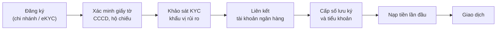
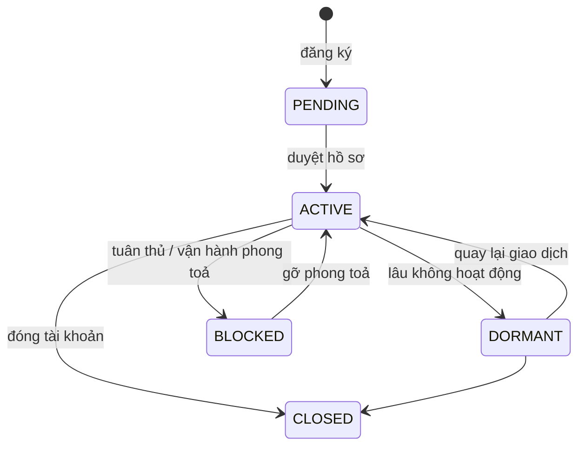

# 3. Khách hàng và tài khoản

Schema: `customer`, `account`.

## 3.1. Hành trình mở tài khoản



| Bước | Bảng | Ghi chú |
|---|---|---|
| Đăng ký | `customer.customers` | `onboarding_channel`: `BRANCH` (tại quầy), `EKYC_MOBILE`, `EKYC_WEB` (định danh điện tử qua app/web), `PARTNER` (qua đối tác) |
| Giấy tờ | `customer.identity_documents` | `CCCD` (căn cước công dân 12 số), `PASSPORT`, `BUSINESS_REGISTRATION` (đăng ký kinh doanh, cho tổ chức) |
| Địa chỉ | `customer.addresses` | Địa chỉ thường trú, liên hệ, trụ sở. Chỉ có phường/xã + tỉnh/thành (đơn vị hành chính 2 cấp) |
| KYC | `customer.kyc_profiles` | Xem mục 3.3 |
| Ngân hàng | `customer.bank_accounts` | Dùng để nạp/rút tiền |
| Tiểu khoản | `account.accounts` | Xem mục 3.4 |
| Nạp tiền | `ledger.cash_transactions` (`DEPOSIT`) | Xem [bài 5](05-thanh-toan-tien-va-chung-khoan.md) |

## 3.2. Bảng `customer.customers`

Một dòng là một **nhà đầu tư**, cá nhân hoặc tổ chức (`customer_type`), trong nước hoặc nước ngoài (`is_foreign`).

### Ba loại mã định danh

| Cột | Ví dụ | Ý nghĩa |
|---|---|---|
| `customer_id` | `1234` | Khoá kỹ thuật (surrogate key) |
| `customer_code` | `KH0001234` | Mã khách hàng nội bộ CTCK |
| `custody_code` | `ZSCC001234` | **Số lưu ký**, định danh với VSDC. Duy nhất trên toàn thị trường |

Số lưu ký có cấu trúc cố định (`CHECK` trong DDL):

```
Z S C   C   0 0 1 2 3 4
└─┬─┘   │   └────┬────┘
mã CTCK │      6 chữ số
        └─ C = khách trong nước
           F = khách nước ngoài
           P = tự doanh của CTCK
```

Khách nước ngoài phải có thêm `foreign_trading_code` (mã số giao dịch do VSDC cấp). DDL ép điều này bằng `CHECK (NOT is_foreign OR foreign_trading_code IS NOT NULL)`.

### Trạng thái khách hàng



### Người phụ trách

- `rm_employee_id`: môi giới hoặc RM (relationship manager) chăm sóc khách. Khách nhỏ thường không có.
- `branch_id`: chi nhánh quản lý khách.
- `referred_by_customer_id`: khách được ai giới thiệu. Đây là khoá ngoại tự tham chiếu tới chính bảng `customers`.

## 3.3. KYC và lịch sử hồ sơ (SCD type 2)

**KYC** (Know Your Customer) là việc CTCK phải hiểu khách hàng của mình: thu nhập, kinh nghiệm, mục tiêu đầu tư, nguồn tiền. Quy định bắt buộc vì hai lý do:

1. **Phòng chống rửa tiền:** biết khách là ai, tiền từ đâu.
2. **Tính phù hợp (suitability):** không bán sản phẩm rủi ro cao cho người không chịu được rủi ro.

Hai cột hay bị nhầm:

| Cột | Ai quyết định | Ý nghĩa |
|---|---|---|
| `risk_rating` (`LOW`/`MEDIUM`/`HIGH`) | Bộ phận tuân thủ | Mức độ rủi ro **rửa tiền** của khách |
| `risk_appetite` (`CONSERVATIVE`/`BALANCED`/`AGGRESSIVE`) | Khách tự khai qua khảo sát | **Khẩu vị đầu tư**: thận trọng, cân bằng, mạo hiểm |

Các cột khác: `is_pep` (người có ảnh hưởng chính trị, cần giám sát kỹ hơn), `is_professional_investor` (nhà đầu tư chuyên nghiệp, được mua trái phiếu riêng lẻ).

### Vì sao là SCD type 2?

Hồ sơ KYC được **đánh giá lại định kỳ**. Không ghi đè hồ sơ cũ, mà đóng hồ sơ cũ và mở hồ sơ mới:

| kyc_profile_id | customer_id | risk_appetite | valid_from | valid_to |
|---|---|---|---|---|
| 101 | 1234 | BALANCED | 2024-03-01 | 2025-05-12 |
| 587 | 1234 | AGGRESSIVE | 2025-05-12 | `NULL` |

- Hồ sơ **hiện tại** là dòng có `valid_to IS NULL`. Unique index `kyc_profiles_one_current` đảm bảo mỗi khách chỉ có tối đa một hồ sơ hiện tại.
- Muốn biết **tại thời điểm X** khách có khẩu vị gì: `WHERE valid_from <= X AND (valid_to IS NULL OR valid_to > X)`.

Đây là điều kiện bắt buộc cho bài toán ML: khi huấn luyện mô hình ở một mốc cắt, chỉ được dùng hồ sơ có hiệu lực **tại mốc đó**, không dùng hồ sơ hiện tại (tránh rò rỉ dữ liệu tương lai).

## 3.4. Tiểu khoản (`account.accounts`)

Một khách có thể có nhiều **tiểu khoản**, mỗi loại tối đa một cái (`UNIQUE (customer_id, account_type)`):

| `account_type` | Tên | Dùng để |
|---|---|---|
| `CASH` | Tiểu khoản thường | Mua bán bằng tiền của chính mình |
| `MARGIN` | Tiểu khoản ký quỹ | Mua bán có vay CTCK. Xem [bài 6](06-margin.md) |
| `BOND` | Tiểu khoản trái phiếu | Giao dịch trái phiếu |
| `FUND` | Tiểu khoản quỹ | Mua bán chứng chỉ quỹ mở |

Số tiểu khoản (`account_no`) = số lưu ký + 1 chữ số đuôi:

```
ZSCC0012341   ← tiểu khoản thường (đuôi 1)
ZSCC0012346   ← tiểu khoản margin (đuôi 6)
```

**Tiền và chứng khoán gắn với tiểu khoản, không gắn với khách hàng.** Đó là lý do mọi bảng giao dịch (`orders`, `cash_balances`, `positions`, `loans`…) dùng `account_id`. Muốn tổng hợp theo khách, phải join qua `account.accounts`.

> **Trong generator:** chỉ sinh tiểu khoản `CASH` và `MARGIN`. Tiểu khoản margin chỉ có ở một phần khách hàng.

## 3.5. Dữ liệu cá nhân (PII)

Các cột có `[PII]` trong comment là dữ liệu cá nhân, cần che (masking) khi đưa ra môi trường phân tích:

- `customers`: `full_name`, `date_of_birth`, `email`, `phone`
- `identity_documents.document_number`
- `addresses.address_line`
- `bank_accounts.account_number`
- `ref.employees.full_name`
- `oms.client_sessions.ip_address`
- `crm.ticket_messages.body` (khách có thể gõ số tài khoản vào tin nhắn)

## 3.6. Phân khúc khách hàng (ẩn)

Khách hàng thật rất khác nhau. Generator gán mỗi khách một **phân khúc ẩn** để tạo hành vi giống thật. Phân khúc này **không lưu trong DB** (CTCK thật cũng không biết chắc), mà ghi ra file ground truth để chấm bài toán phân cụm.

| Phân khúc | Tỷ lệ khách | Lệnh/ngày (tương đối) | Tài sản điển hình | Hành vi |
|---|---|---|---|---|
| `DORMANT` | 28% | gần 0 | ~30 triệu | Mở tài khoản rồi bỏ đó |
| `PASSIVE` | 34% | rất thấp | ~150 triệu | Thỉnh thoảng mua, giữ lâu |
| `ACTIVE` | 24% | trung bình | ~600 triệu | Giao dịch đều, ~45% có margin |
| `DAY_TRADER` | 6% | rất cao | ~1,2 tỷ | Lướt sóng trong ngày, ~85% dùng margin, khẩu vị mạo hiểm |
| `HNW` | 5% | khá | ~8 tỷ | Khách giàu, luôn có RM, gói phí VIP |
| `INSTITUTION` | 3% | cao | ~40 tỷ | Tổ chức, đặt lệnh qua API, không dùng margin |

Hệ quả bạn sẽ thấy trong dữ liệu:

- **Phân phối Pareto:** khoảng 20% khách tạo khoảng 80% số lệnh.
- Gần 1/3 tài khoản hầu như không giao dịch.
- Gói phí được gán theo phân khúc: tổ chức → `INSTITUTION`, HNW → `VIP`, khách có môi giới → `BROKER_ASSIST`, còn lại → `ONLINE_STD`.

---

← [2. Sản phẩm và thị trường](02-san-pham-va-thi-truong.md) · Tiếp theo: [4. Vòng đời lệnh →](04-vong-doi-lenh.md)
