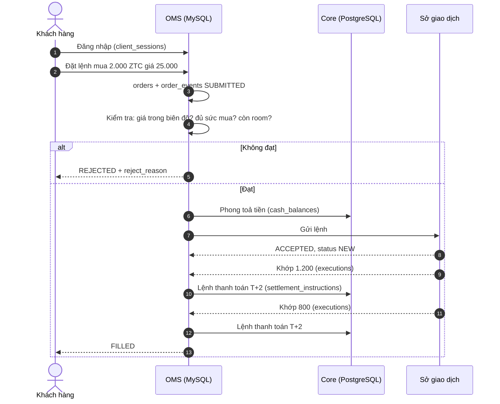
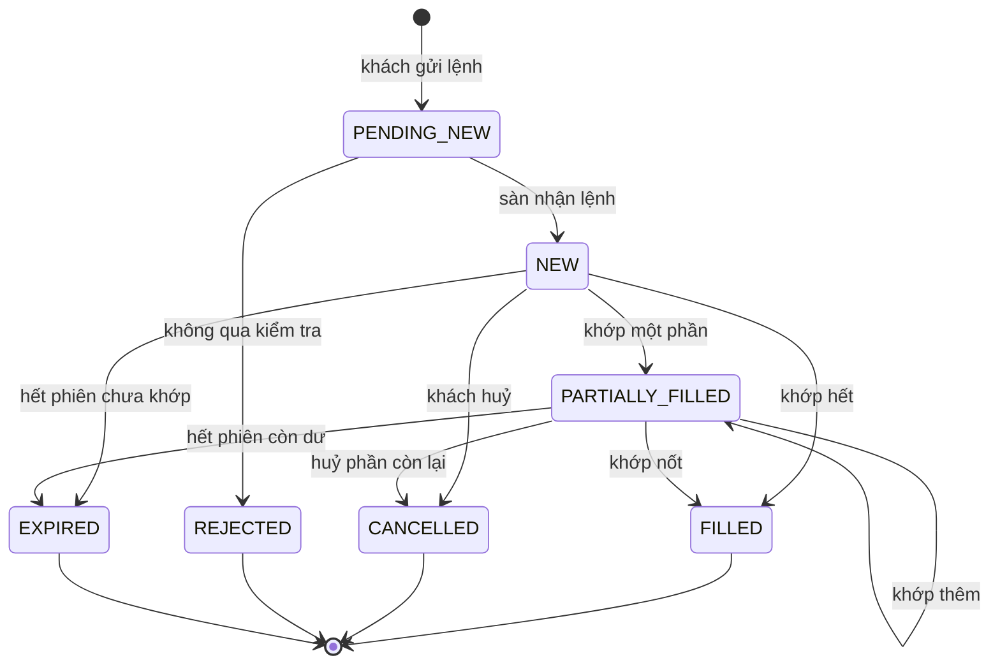

# 4. Vòng đời lệnh

Schema: MySQL `oms` (`orders`, `order_events`, `executions`, `client_sessions`, `watchlists`).

Đây là phần "nóng" nhất của hệ thống: trong giờ giao dịch, mỗi giây có thể có hàng trăm thay đổi.

## 4.1. Từ lúc bấm "Mua" đến khi khớp



## 4.2. Kiểm tra trước khi gửi lệnh (pre-trade check)

OMS chặn lệnh ngay từ đầu nếu vi phạm điều kiện. Lệnh bị chặn có `status = 'REJECTED'` và `reject_reason`:

| `reject_reason` | Khi nào |
|---|---|
| `PRICE_OUT_OF_BAND` | Giá đặt cao hơn trần hoặc thấp hơn sàn |
| `INSUFFICIENT_BUYING_POWER` | Lệnh mua cần nhiều tiền hơn sức mua |
| `INSUFFICIENT_SECURITIES` | Lệnh bán nhiều hơn số chứng khoán khả dụng |
| `FOREIGN_ROOM_EXCEEDED` | Khách nước ngoài mua mã đã hết room |

### Sức mua

**Sức mua** = tiền khả dụng + hạn mức vay margin còn lại (nếu là tiểu khoản margin).

Số tiền cần cho một lệnh mua đã **tính luôn phí**:

```
Tiền cần = số lượng × giá × (1 + tỷ lệ phí)
```

Với lệnh không có giá (MP, ATO, ATC…), OMS dùng **giá trần** để tính, vì đó là mức giá cao nhất có thể khớp.

**Ví dụ.** Mua 2.000 `ZTC` giá 25.000, gói phí 0,15%:

```
2.000 × 25.000 × 1,0015 = 50.075.000đ
```

Nếu tiền khả dụng ≥ 50.075.000đ, lệnh được nhận và số tiền này bị **phong toả** (chuyển từ "khả dụng" sang "phong toả"). Nếu không đủ nhưng tiểu khoản margin còn hạn mức vay, phần thiếu được giữ chỗ từ hạn mức và lệnh có `is_margin = TRUE`.

Với lệnh bán, OMS phong toả **chứng khoán**: số lượng chuyển từ `available_quantity` sang `blocked_quantity` trong `custody.positions`.

## 4.3. Trạng thái lệnh



`FILLED`, `CANCELLED`, `REJECTED`, `EXPIRED` là **trạng thái kết thúc**: lệnh không đổi nữa.

Ở thị trường Việt Nam, lệnh trên sàn **chỉ có hiệu lực trong ngày**. Cuối phiên, lệnh nào còn mở đều hết hạn. Muốn tiếp tục, hôm sau khách phải đặt lại. Vì vậy mỗi lệnh có `trade_date` và các thống kê lệnh luôn tính theo ngày.

> **Trong generator:** `PENDING_NEW` không xuất hiện trong `oms.orders`, vì kiểm tra diễn ra ngay khi lệnh được tạo. Dòng đầu tiên của lệnh đã là `NEW` hoặc `REJECTED`. Chỉ cổ phiếu và ETF được giao dịch.

## 4.4. `orders` và `order_events`: snapshot và nhật ký

- `oms.orders`: **một dòng mỗi lệnh**, luôn phản ánh trạng thái mới nhất. Mỗi lần thay đổi thì `version` tăng 1.
- `oms.order_events`: **một dòng mỗi sự kiện**, chỉ insert. Đây là lịch sử đầy đủ của lệnh.

| `event_type` | Ý nghĩa | `source` thường gặp |
|---|---|---|
| `SUBMITTED` | Lệnh được gửi | `CLIENT`, `BROKER`, `SYSTEM` |
| `ACCEPTED` | Sàn nhận lệnh | `EXCHANGE` |
| `REJECTED` | Bị từ chối | `SYSTEM` |
| `MODIFIED` | Sửa giá/khối lượng (`old_price` → `new_price`) | `CLIENT`, `BROKER` |
| `CANCEL_REQUESTED` | Khách yêu cầu huỷ | `CLIENT`, `BROKER` |
| `CANCELLED` | Sàn xác nhận huỷ | `EXCHANGE` |
| `PARTIALLY_FILLED` | Khớp một phần (`new_quantity`, `new_price` = khối lượng và giá **của lần khớp này**) | `EXCHANGE` |
| `FILLED` | Khớp hết | `EXCHANGE` |
| `EXPIRED` | Hết hạn | `SYSTEM` |

`source = 'SYSTEM'` ở sự kiện `SUBMITTED` nghĩa là lệnh do **hệ thống** tự đặt, điển hình là lệnh bán giải chấp margin ([bài 6](06-margin.md)).

### Ví dụ: một lệnh mua khớp hai lần

Lệnh mua 2.000 `ZTC` giá 25.000, phí 0,15%, đặt lúc 09:20:01.

**`oms.order_events`** (giờ Việt Nam):

| event_time | event_type | new_quantity | new_price | source |
|---|---|---|---|---|
| 09:20:01.000 | SUBMITTED | | | CLIENT |
| 09:20:01.060 | ACCEPTED | | | EXCHANGE |
| 09:34:12.410 | PARTIALLY_FILLED | 1.200 | 25.000 | EXCHANGE |
| 09:41:07.882 | FILLED | 800 | 25.000 | EXCHANGE |

**`oms.executions`**: mỗi lần khớp một dòng.

| execution_id | matched_quantity | matched_price | matched_value | fee_amount | tax_amount |
|---|---|---|---|---|---|
| 9001 | 1.200 | 25.000 | 30.000.000 | 45.000 | 0 |
| 9002 | 800 | 25.000 | 20.000.000 | 30.000 | 0 |

**`oms.orders`**: một dòng, được update nhiều lần. Trạng thái cuối:

| order_no | status | quantity | filled_quantity | average_fill_price | version |
|---|---|---|---|---|---|
| 20250616-000012345 | FILLED | 2.000 | 2.000 | 25.000 | 3 |

Dòng này đã đi qua ba phiên bản: `NEW` (version 1) → `PARTIALLY_FILLED` (2) → `FILLED` (3). CDC sẽ bắt được cả ba, nhưng query vào DB chỉ thấy bản cuối. `average_fill_price` là giá khớp bình quân gia quyền theo khối lượng.

## 4.5. Khớp lệnh: `executions`

Mỗi dòng `oms.executions` là **một lần khớp** do sàn xác nhận (`exchange_exec_no` là số hiệu khớp của sàn).

- Một lệnh có thể có **nhiều** executions (khớp từng phần).
- Mỗi execution sinh ra **một** lệnh thanh toán T+2 ở core: `custody.settlement_instructions.execution_id` là tham chiếu logic tới `oms.executions.execution_id` (khác DB, không có FK).
- `fee_amount` = giá trị khớp × tỷ lệ phí của gói. `tax_amount` = 0,1% giá trị khớp, **chỉ với lệnh bán**.

Executions **không cho biết đối ứng** là ai. Người bán cho khách ZSC có thể là khách của một CTCK khác. Generator chỉ mô phỏng phía ZSC.

## 4.6. Sửa, huỷ, hết hạn

| Hành động | Dấu vết | Ảnh hưởng tiền/chứng khoán |
|---|---|---|
| **Huỷ** | `CANCEL_REQUESTED` → `CANCELLED` | Phần tiền / chứng khoán còn phong toả được trả lại khả dụng |
| **Sửa giá** | `MODIFIED` với `old_price`, `new_price` | Nếu giá mua tăng, phong toả thêm tiền |
| **Hết hạn cuối phiên** | `EXPIRED`, `reason = 'END_OF_DAY'` | Trả lại phần còn phong toả |
| ATO không khớp | `EXPIRED`, `reason = 'ATO_UNMATCHED'` | Như trên |
| MOK không khớp đủ / MAK còn dư | `CANCELLED`, `reason` bắt đầu bằng `MOK_` / `MAK_` | Như trên |

Một lệnh đã khớp một phần rồi bị huỷ sẽ có `status = 'CANCELLED'` nhưng `filled_quantity > 0`. Khi tính "số lệnh khớp", đừng chỉ lọc `status = 'FILLED'`.

> **Trong generator:** khoảng 10% lệnh LO bị khách huỷ, khoảng 4,5% bị sửa giá. Lệnh margin không bị sửa. Khoảng 0,4% lệnh LO cố ý đặt ngoài biên độ để sinh lệnh bị từ chối.

## 4.7. Lệnh bán khác lệnh mua ở đâu?

| | Lệnh mua | Lệnh bán |
|---|---|---|
| Phong toả khi đặt | Tiền (`cash_balances.blocked_amount`) | Chứng khoán (`positions.blocked_quantity`) |
| Kiểm tra | Sức mua | Số chứng khoán khả dụng |
| Khi khớp | Tiền chuyển sang "chờ thanh toán" (`payable_amount`), cổ phiếu vào "chờ về" (`receiving_quantity`) | Chứng khoán rời tài khoản, tiền vào "chờ về" (`receivable_amount`) |
| Phí và thuế | Phí | Phí + thuế bán 0,1% |

Chi tiết từng bước nằm ở [bài 5](05-thanh-toan-tien-va-chung-khoan.md).

## 4.8. Dấu vết CDC của một lệnh mua

Với người làm streaming, đây là danh sách event mà Debezium sẽ bắt được cho **một** lệnh mua khớp hết trong một lần:

| Thời điểm | DB | Bảng | Thao tác |
|---|---|---|---|
| T, lúc đặt | MySQL | `oms.order_events` | insert `SUBMITTED`, `ACCEPTED` |
| | MySQL | `oms.orders` | insert (`NEW`) |
| | PG | `ledger.cash_balances` | update: khả dụng ↓, phong toả ↑ |
| T, lúc khớp | MySQL | `oms.executions` | insert |
| | MySQL | `oms.order_events` | insert `FILLED` |
| | MySQL | `oms.orders` | update (`FILLED`) |
| | PG | `custody.settlement_instructions` | insert (`PENDING`) |
| | PG | `ledger.cash_balances` | update: phong toả ↓, chờ thanh toán ↑ |
| | PG | `custody.positions` | insert/update: tổng ↑, chờ về ↑ |
| T+2, 08:30 | PG | `ledger.cash_transactions` | insert `BUY_SETTLEMENT`, `TRADING_FEE` |
| | PG | `custody.position_movements` | insert `BUY_SETTLED` |
| | PG | `custody.positions` | update: chờ về ↓, khả dụng ↑ |
| | PG | `ledger.cash_balances` | update: chờ thanh toán ↓ |
| | PG | `custody.settlement_instructions` | update (`SETTLED`) |

Một hành động của khách sinh ra ~14 event trên 2 DB, rải ra trong 3 ngày làm việc. Đây chính là bài toán "join stream nhiều nguồn, có độ trễ khác nhau".

## 4.9. Phiên đăng nhập và danh mục theo dõi

- `oms.client_sessions`: mỗi lần đăng nhập một dòng, kể cả đăng nhập lỗi (`WRONG_PASSWORD`, `WRONG_OTP`, `LOCKED`). `device_id` là dấu vân tay thiết bị đã băm. **Một thiết bị đăng nhập vào nhiều khách khác nhau** là tín hiệu gian lận.
- `oms.watchlists`, `oms.watchlist_items`: danh sách mã khách theo dõi trên app. `removed_at` là xoá mềm, giữ lại lịch sử thêm/bớt cho mô hình gợi ý.
- Kafka topic `app.clickstream`: hành vi xem mã trên app (không lưu DB).

---

← [3. Khách hàng và tài khoản](03-khach-hang-va-tai-khoan.md) · Tiếp theo: [5. Thanh toán T+2 →](05-thanh-toan-tien-va-chung-khoan.md)
