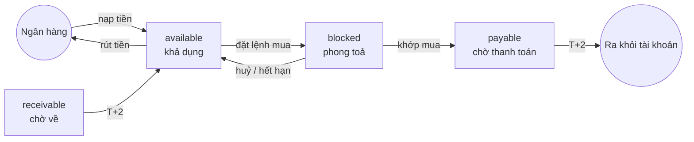

# 5. Thanh toán T+2, tiền và chứng khoán

Schema: `ledger`, `custody`.

Đây là bài quan trọng nhất cho người làm dữ liệu, vì nó giải thích vì sao **số dư hiện tại** và **lịch sử giao dịch** không khớp nhau tại mọi thời điểm.

## 5.1. T+2 là gì?

Khi lệnh khớp vào ngày **T**, tiền và chứng khoán **chưa** đổi chủ ngay. Việc đổi chủ thật (thanh toán, settlement) diễn ra vào **T+2**: ngày làm việc thứ hai sau T.

"Ngày làm việc" bỏ qua cuối tuần và ngày lễ, dựa trên `ref.trading_calendar`:

| Ngày khớp (T) | T+1 | T+2 | Ghi chú |
|---|---|---|---|
| Thứ Hai 16/06/2025 | Thứ Ba 17/06 | Thứ Tư 18/06 | Bình thường |
| Thứ Năm 12/06/2025 | Thứ Sáu 13/06 | **Thứ Hai 16/06** | Bỏ qua cuối tuần |
| Thứ Ba 29/04/2025 | **Thứ Sáu 02/05** | **Thứ Hai 05/05** | Bỏ qua lễ 30/4, 1/5 và cuối tuần |

Trong khoảng T → T+2, tiền và chứng khoán ở trạng thái "đang trên đường". Schema mô hình hoá trạng thái này bằng các "ngăn" riêng.

## 5.2. Các ngăn của tiền: `ledger.cash_balances`

Một dòng cho mỗi tiểu khoản:

| Cột | Tên gọi | Ý nghĩa |
|---|---|---|
| `available_amount` | Tiền khả dụng | Dùng được ngay để mua, rút |
| `blocked_amount` | Tiền phong toả | Đang bị giữ cho lệnh mua chưa khớp (hoặc lệnh rút đang xử lý) |
| `payable_amount` | Tiền chờ thanh toán | Lệnh mua **đã khớp**, sẽ bị trừ vào T+2 |
| `receivable_amount` | Tiền chờ về | Lệnh bán **đã khớp**, sẽ về tài khoản vào T+2 (sau phí, thuế) |



`receivable` được nạp vào khi **lệnh bán khớp** (không có trên hình để đỡ rối).

## 5.3. Các ngăn của chứng khoán: `custody.positions`

Một dòng cho mỗi cặp (tiểu khoản, mã):

| Cột | Tên gọi | Ý nghĩa |
|---|---|---|
| `total_quantity` | Tổng | Tổng số đang sở hữu (kể cả chưa về) |
| `available_quantity` | Khả dụng | Bán được ngay |
| `receiving_quantity` | Chờ về | Đã mua khớp, chưa thanh toán (T0 → T2) |
| `blocked_quantity` | Phong toả | Đang bị giữ cho lệnh bán chưa khớp |
| `pledged_quantity` | Cầm cố | Dùng làm tài sản bảo đảm |
| `average_cost` | Giá vốn | Giá mua bình quân, **đã gồm phí** |

`total_quantity = available + receiving + blocked + pledged`.

Khi bán hết, dòng **không bị xoá**, chỉ về 0. Muốn lấy danh mục đang nắm giữ, lọc `total_quantity > 0`.

> **Trong generator:** `pledged_quantity` luôn bằng 0.

## 5.4. Ví dụ đầy đủ: mua rồi bán

Tiếp tục ví dụ ở [bài 4](04-vong-doi-lenh.md#ví-dụ-một-lệnh-mua-khớp-hai-lần). Khách có 100.000.000đ khả dụng, gói phí 0,15%, mua 2.000 `ZTC` giá 25.000 vào thứ Hai 16/06/2025. Lệnh khớp làm hai lần: 1.200 và 800.

### Phần tiền (`ledger.cash_balances`)

| Thời điểm | Sự kiện | available | blocked | payable |
|---|---|---|---|---|
| T, đầu ngày | | 100.000.000 | 0 | 0 |
| T, 09:20 | Đặt lệnh, phong toả 50.075.000 | 49.925.000 | 50.075.000 | 0 |
| T, 09:34 | Khớp 1.200 (30.000.000 + phí 45.000) | 49.925.000 | 20.030.000 | 30.045.000 |
| T, 09:41 | Khớp 800 (20.000.000 + phí 30.000) | 49.925.000 | 0 | 50.075.000 |
| T+2 (18/06), 08:30 | Thanh toán | 49.925.000 | 0 | **0** |

Để ý: tiền khả dụng giảm **ngay khi đặt lệnh**, không phải lúc thanh toán. Với khách, tiền đã "mất" từ ngày T.

### Phần chứng khoán (`custody.positions`)

| Thời điểm | total | available | receiving | average_cost |
|---|---|---|---|---|
| T, sau khớp 1 | 1.200 | 0 | 1.200 | 25.037,5 |
| T, sau khớp 2 | 2.000 | 0 | 2.000 | 25.037,5 |
| T+2, 08:30 | 2.000 | **2.000** | 0 | 25.037,5 |

Giá vốn = (50.000.000 + 75.000 phí) / 2.000 = 25.037,5đ. Trước T+2, khách **chưa bán được** số cổ phiếu này vì `available_quantity = 0`.

### Phần thanh toán (`custody.settlement_instructions`)

Mỗi lần khớp sinh một lệnh thanh toán:

| settlement_id | execution_id | side | gross_amount | fee_amount | net_amount | trade_date | settle_date | status |
|---|---|---|---|---|---|---|---|---|
| 501 | 9001 | BUY | 30.000.000 | 45.000 | 30.045.000 | 2025-06-16 | 2025-06-18 | PENDING → SETTLED |
| 502 | 9002 | BUY | 20.000.000 | 30.000 | 20.030.000 | 2025-06-16 | 2025-06-18 | PENDING → SETTLED |

`net_amount`: với lệnh mua = gốc + phí (tiền ra); với lệnh bán = gốc − phí − thuế (tiền vào).

### Phần nhật ký (chỉ xuất hiện vào T+2)

`ledger.cash_transactions`, giả sử số dư sổ trước đó là 100.000.000:

| txn_type | amount | balance_after | reference_type | reference_id |
|---|---|---|---|---|
| BUY_SETTLEMENT | −30.000.000 | 70.000.000 | SETTLEMENT | 501 |
| TRADING_FEE | −45.000 | 69.955.000 | SETTLEMENT | 501 |
| BUY_SETTLEMENT | −20.000.000 | 49.955.000 | SETTLEMENT | 502 |
| TRADING_FEE | −30.000 | 49.925.000 | SETTLEMENT | 502 |

`custody.position_movements`: hai dòng `BUY_SETTLED` (+1.200 và +800), `settle_date = 2025-06-18`.

### Bán ra

Thứ Hai 23/06, khách bán cả 2.000 `ZTC` giá 27.000, khớp một lần:

```
Giá trị khớp   2.000 × 27.000      = 54.000.000
Phí 0,15%                          =     81.000
Thuế bán 0,1%                      =     54.000
Tiền thực nhận 54.000.000 − 81.000 − 54.000 = 53.865.000
```

| Thời điểm | positions: total / available / blocked | cash: available / receivable |
|---|---|---|
| T, đặt lệnh bán | 2.000 / 0 / 2.000 | 49.925.000 / 0 |
| T, khớp | **0** / 0 / 0 | 49.925.000 / 53.865.000 |
| T+2 (25/06), 08:30 | 0 / 0 / 0 | **103.790.000** / 0 |

Vào T+2, `cash_transactions` có ba dòng: `SELL_SETTLEMENT` +54.000.000, `TRADING_FEE` −81.000, `SELLING_TAX` −54.000. `position_movements` có một dòng `SELL_SETTLED` −2.000.

Lãi của khách = 53.865.000 − 50.075.000 = **3.790.000đ**.

## 5.5. Các loại giao dịch tiền

`ledger.cash_transactions.amount` **có dấu**: dương là tiền vào, âm là tiền ra.

| `txn_type` | Dấu | Sinh ra khi | Xem bài |
|---|---|---|---|
| `DEPOSIT` / `WITHDRAWAL` | + / − | Nạp / rút qua ngân hàng | |
| `BUY_SETTLEMENT` / `SELL_SETTLEMENT` | − / + | Thanh toán T+2 | 5 |
| `TRADING_FEE` | − | Phí môi giới, thu khi thanh toán | 5 |
| `SELLING_TAX` | − | Thuế bán 0,1% | 5 |
| `CASH_DIVIDEND` / `DIVIDEND_TAX` | + / − | Nhận cổ tức tiền, khấu trừ thuế 5% | 7 |
| `LOAN_DISBURSEMENT` / `LOAN_REPAYMENT` | + / − | Giải ngân / trả nợ margin | 6 |
| `MARGIN_INTEREST` | − | Thu lãi vay margin | 6 |
| `INTERNAL_TRANSFER_IN` / `_OUT` | + / − | Chuyển tiền giữa các tiểu khoản | |
| `FUND_SUBSCRIPTION` / `FUND_REDEMPTION` | − / + | Mua / bán chứng chỉ quỹ mở | |
| `ADJUSTMENT` | ± | Điều chỉnh, số dư đầu kỳ (`reference_type = 'OPENING_BALANCE'`) | |

`reference_type` + `reference_id` cho biết dòng này đến từ đâu: `SETTLEMENT` → `settlement_id`, `CORPORATE_ACTION` → `entitlement_id`, `LOAN` → `loan_id`.

`value_date` là **ngày nghiệp vụ** (ngày tiền có hiệu lực), khác `created_at` là thời điểm ghi sổ.

## 5.6. Đối soát snapshot với nhật ký

`balance_after` là số dư luỹ kế của nhật ký sau mỗi dòng. Câu hỏi tự nhiên: `balance_after` cuối cùng có bằng `available_amount` không?

**Không.** Vì nhật ký chỉ ghi khi tiền **thực sự** di chuyển (nạp, rút, T+2), còn snapshot thay đổi cả khi tiền chỉ **chuyển ngăn** (phong toả, chờ thanh toán). Quy tắc đúng là:

```
balance_after cuối cùng  =  available + blocked + payable
```

- `blocked` và `payable` vẫn là tiền của khách, chưa rời sổ cho đến T+2 → **được tính**.
- `receivable` là tiền bán chưa về, chưa vào sổ cho đến T+2 → **không tính**.

Đây là phép đối soát mà bộ phận kế toán của CTCK chạy hằng ngày. Bài tập ở [bài 11](11-bai-tap.md) hướng dẫn kiểm tra bằng SQL. Với chứng khoán, `position_movements` cũng chỉ ghi vào T+2, trong khi `positions.total_quantity` thay đổi ngay lúc khớp. Vì vậy cộng dồn `position_movements` **không** cho ra `total_quantity` ở mọi thời điểm.

Với streaming, đây là bài học quan trọng: **đừng tái tạo trạng thái từ một nguồn sự kiện duy nhất** nếu nguồn đó không ghi mọi thay đổi trạng thái. Hoặc dùng CDC của bảng snapshot, hoặc kết hợp nhiều nguồn sự kiện.

## 5.7. Những thứ ngoài đời có nhưng dataset không mô phỏng

- **Ứng trước tiền bán:** khách bán ở T muốn dùng tiền ngay, CTCK cho "ứng" tiền chờ về và thu phí. Rất phổ biến ở Việt Nam.
- **Thanh toán lỗi** (`status = 'FAILED'`): DDL có trạng thái này nhưng generator không sinh.
- **Bán chứng khoán chờ về:** một số thị trường cho bán cổ phiếu trước khi về tài khoản. Trong dataset, chỉ bán được phần `available_quantity`.

> **Trong generator:** thanh toán T+2 chạy lúc 08:30 sáng ngày T+2, trước giờ mở cửa, nên khách bán được cổ phiếu ngay trong phiên T+2.

---

← [4. Vòng đời lệnh](04-vong-doi-lenh.md) · Tiếp theo: [6. Margin →](06-margin.md)
