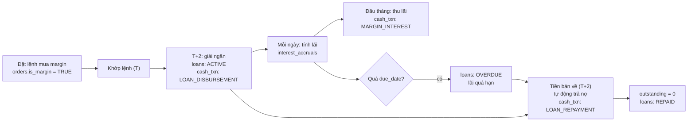
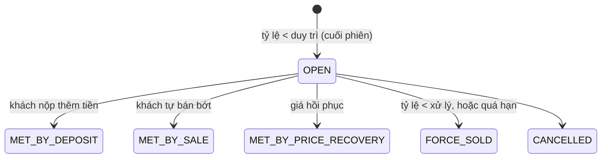

# 6. Giao dịch ký quỹ (margin)

Schema: `margin` (`loan_products`, `marginable_instruments`, `loans`, `interest_accruals`, `margin_calls`).

## 6.1. Margin là gì?

**Giao dịch ký quỹ** là vay tiền CTCK để mua chứng khoán, dùng chính chứng khoán đó làm tài sản bảo đảm. Đây là nguồn thu lớn thứ hai của CTCK sau phí môi giới.

Margin là **đòn bẩy hai chiều**. Khách có 100 triệu, vay thêm 100 triệu, mua 200 triệu cổ phiếu:

| Giá cổ phiếu | Giá trị danh mục | Lãi/lỗ | So với vốn 100 triệu |
|---|---|---|---|
| +10% | 220 triệu | +20 triệu | **+20%** |
| −10% | 180 triệu | −20 triệu | **−20%** |

Không dùng margin, cùng biến động giá chỉ lãi/lỗ 10%. Dùng margin, lãi và lỗ đều gấp đôi (chưa tính lãi vay).

Vì CTCK chịu rủi ro mất tiền cho vay, họ đặt ra các ngưỡng để **thu hồi nợ trước khi tài sản của khách không đủ trả**. Toàn bộ schema `margin` xoay quanh các ngưỡng này.

## 6.2. Gói vay và danh mục cho vay

### `margin.loan_products`: gói vay

| Gói | Lãi suất/năm | Ký quỹ ban đầu | Duy trì | Xử lý | Hạn mức tối đa | Kỳ hạn |
|---|---|---|---|---|---|---|
| `MR_STD` | 13,5% | 50% | 40% | 30% | 5 tỷ | 90 ngày |
| `MR_VIP` | 11,5% | 50% | 40% | 30% | 50 tỷ | 180 ngày |
| `MR_PROMO` | 9,9% | 50% | 40% | 30% | 1 tỷ | 30 ngày |

Ba ngưỡng tỷ lệ luôn thoả `ban đầu > duy trì > xử lý` (DDL có `CHECK`):

- **Tỷ lệ ký quỹ ban đầu** (`initial_margin_ratio_pct`): khách phải tự bỏ ít nhất bao nhiêu % khi mua. 50% nghĩa là vay tối đa bằng số vốn tự có.
- **Tỷ lệ duy trì** (`maintenance_ratio_pct`): dưới ngưỡng này, CTCK **gọi ký quỹ** (margin call).
- **Tỷ lệ xử lý** (`force_sell_ratio_pct`): dưới ngưỡng này, CTCK **bán giải chấp** (force sell).

### `margin.marginable_instruments`: danh mục cho vay

Không phải mã nào cũng được vay. CTCK công bố danh sách mã được cho vay kèm **tỷ lệ cho vay** (`loan_ratio_pct`, tối đa 50% theo quy định). Mã có tỷ lệ 30% nghĩa là 100 triệu cổ phiếu mã đó chỉ giúp vay được 30 triệu.

`max_price` giới hạn giá dùng để định giá tài sản bảo đảm, tránh trường hợp mã bị đẩy giá ảo. Bảng có `effective_from`/`effective_to` vì danh mục thay đổi định kỳ: mã đang được vay có thể bị loại khỏi danh sách.

## 6.3. Sức mua margin

Với tiểu khoản margin:

```
Sức mua = tiền khả dụng + hạn mức vay còn lại
```

Hạn mức vay còn lại ước tính bằng tổng (giá trị chứng khoán × tỷ lệ cho vay của mã), giới hạn bởi hạn mức tối đa của gói, trừ đi dư nợ hiện có. Khi lệnh mua cần nhiều hơn tiền khả dụng, phần thiếu lấy từ hạn mức và lệnh có `oms.orders.is_margin = TRUE`.

## 6.4. Vòng đời một khoản vay



Chi tiết:

- **Giải ngân:** khoản vay được tạo khi lệnh mua margin **thanh toán** vào T+2, không phải khi khớp. Mỗi lần giải ngân là một dòng `margin.loans`. `principal_amount` là gốc ban đầu, `outstanding_amount` là dư nợ còn lại.
- **Tính lãi hằng ngày:** `margin.interest_accruals` có một dòng mỗi khoản vay mỗi ngày giao dịch. Lãi tính theo **ngày lịch, cơ sở actual/365**:

  ```
  Lãi 1 ngày = 100.000.000 × 13,5% / 365 = 36.986đ
  ```

  Dòng của thứ Hai gánh cả thứ Bảy và Chủ nhật: 36.986 × 3 ≈ 110.959đ.
- **Thu lãi:** lãi cộng dồn được thu vào ngày giao dịch đầu tiên của tháng (`MARGIN_INTEREST`). Nếu tiền khả dụng không đủ, phần thiếu **nhập vào gốc** (tăng `outstanding_amount`).
- **Quá hạn:** qua `due_date` mà chưa trả hết thì `status = 'OVERDUE'`, lãi suất quá hạn áp dụng (`is_overdue = true` trong `interest_accruals`).
- **Trả nợ:** khi tiền bán chứng khoán về (T+2), hệ thống tự động trả nợ (`LOAN_REPAYMENT`). Trả hết thì `status = 'REPAID'`.

> **Trong generator:** lãi suất quá hạn bằng 150% lãi thường. Trạng thái `loans` sinh ra chủ yếu là `ACTIVE`, `OVERDUE`, `REPAID`.

## 6.5. Tỷ lệ ký quỹ và call margin

Mỗi cuối phiên, CTCK tính **tỷ lệ ký quỹ** của từng tiểu khoản có nợ:

```
Tổng tài sản   = tiền khả dụng + tiền chờ về + Σ(số lượng CK × giá đóng cửa)
Tài sản ròng   = Tổng tài sản − Dư nợ
Tỷ lệ ký quỹ   = Tài sản ròng / Tổng tài sản × 100%
```

### Ví dụ với gói `MR_STD` (duy trì 40%, xử lý 30%)

Khách có 100 triệu, vay 100 triệu, mua 200 triệu cổ phiếu. Tiền mặt còn 0.

| Diễn biến giá | Giá trị CK | Nợ | Tài sản ròng | Tỷ lệ | Hệ quả |
|---|---|---|---|---|---|
| Ban đầu | 200 | 100 | 100 | 50,0% | |
| Giảm 15% | 170 | 100 | 70 | 41,2% | An toàn |
| Giảm 20% | 160 | 100 | 60 | **37,5%** | < 40% → **call margin** |
| Giảm 30% | 140 | 100 | 40 | **28,6%** | < 30% → **bán giải chấp** |

(đơn vị: triệu đồng)

### Phải nộp bao nhiêu khi bị call?

Ở dòng "giảm 20%", khách phải nộp thêm X tiền để tỷ lệ về lại 40%. Nộp tiền làm **cả** tài sản lẫn tài sản ròng tăng X:

```
(60 + X) / (160 + X) = 0,4   →   X = (0,4 × 160 − 60) / (1 − 0,4) ≈ 6,67 triệu
```

Công thức tổng quát (lưu ở `margin_calls.required_amount`, làm tròn đến 100.000đ):

```
required = (tỷ lệ duy trì × Tổng tài sản − Tài sản ròng) / (1 − tỷ lệ duy trì)
```

## 6.6. Xử lý call margin



Mỗi dòng `margin.margin_calls` ghi:

- `call_date`, `margin_ratio_pct` (tỷ lệ tại thời điểm call), `required_amount`.
- `deadline_at`: hạn để khách bổ sung. Thông báo qua `notified_channels` (SMS, email, app).
- `status` cuối cùng cho biết call được giải quyết thế nào.

**Bán giải chấp** (force sell): CTCK tự đặt lệnh bán chứng khoán của khách để thu hồi nợ. Dấu vết trong OMS:

- `oms.orders` với `side = 'SELL'`, `order_type = 'LO'`, giá đặt **bằng giá sàn** (để chắc chắn khớp), `channel = 'BROKER'`.
- `oms.order_events` có `SUBMITTED` với `source = 'SYSTEM'`.
- Bán các mã có giá trị lớn nhất trước, đến khi đủ khoảng 110% dư nợ.

> **Trong generator:** kiểm tra tỷ lệ chạy lúc 15:00 mỗi ngày, sau khi có giá đóng cửa. Hạn bổ sung là 14:30 của ngày làm việc thứ hai sau ngày call. Nếu tỷ lệ rơi dưới ngưỡng xử lý hoặc đến hạn mà chưa đủ, lệnh bán giải chấp được đặt lúc 09:05 sáng ngày giao dịch kế tiếp. Khách HNW có khoảng 60% khả năng nộp tiền, khách thường khoảng 35%. Khoảng 30% khách bị call mở ticket hỗ trợ loại `MARGIN` vào hôm sau.

## 6.7. Vì sao phần này hay cho ML và streaming?

- **Nhãn rủi ro tín dụng:** `margin_calls.status = 'FORCE_SOLD'`. Tín hiệu generator cài vào: danh mục tập trung vào một mã, khách khẩu vị `AGGRESSIVE`.
- **Tính tỷ lệ ký quỹ real-time:** CTCK thật cảnh báo trong phiên, không chờ cuối ngày. Đây là bài toán streaming kinh điển: join `marketdata.ticks` (giá) với `custody.positions` (CDC) và `margin.loans` (CDC), tính lại tỷ lệ mỗi khi giá đổi, phát cảnh báo khi xuống dưới ngưỡng.

---

← [5. Thanh toán T+2](05-thanh-toan-tien-va-chung-khoan.md) · Tiếp theo: [7. Quyền cổ đông →](07-quyen-co-dong.md)
