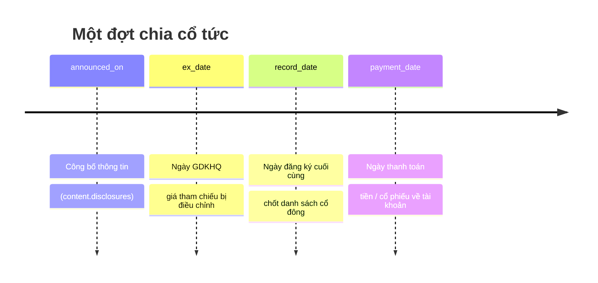
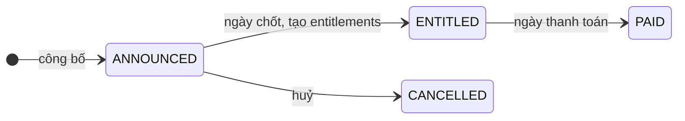

# 7. Quyền cổ đông (corporate actions)

Schema: `corp_action` (`events`, `entitlements`).

## 7.1. Sự kiện quyền là gì?

Khi sở hữu cổ phiếu, bạn là **cổ đông** và có quyền nhận những thứ công ty chia cho cổ đông. Mỗi lần công ty chia là một **sự kiện quyền** (corporate action). CTCK phải tính xem mỗi khách được bao nhiêu và chi trả vào tài khoản.

| `ca_type` | Tên | Khách nhận được | Ví dụ |
|---|---|---|---|
| `CASH_DIVIDEND` | Cổ tức tiền mặt | Tiền | 1.000đ/cổ phiếu (= 10% mệnh giá) |
| `STOCK_DIVIDEND` | Cổ tức bằng cổ phiếu | Cổ phiếu mới | Tỷ lệ 100:15 → cứ 100 cổ phiếu được thêm 15 |
| `BONUS_SHARES` | Cổ phiếu thưởng | Cổ phiếu mới | Tương tự cổ tức cổ phiếu |
| `RIGHTS_ISSUE` | Quyền mua cổ phiếu phát hành thêm | Quyền được mua thêm với `subscription_price` (thường rẻ hơn giá thị trường) | |
| `STOCK_SPLIT` | Chia tách cổ phiếu | Nhiều cổ phiếu hơn, giá mỗi cổ phiếu giảm tương ứng | |
| `BOND_COUPON` | Trả lãi trái phiếu | Tiền | |
| `BOND_MATURITY` | Đáo hạn trái phiếu | Tiền gốc | |

Tỷ lệ được lưu bằng `ratio_numerator : ratio_denominator`. Với `STOCK_DIVIDEND` 100:15, `ratio_numerator = 100`, `ratio_denominator = 15`.

> **Trong generator:** chỉ sinh `CASH_DIVIDEND` (khoảng 80%) và `STOCK_DIVIDEND` (khoảng 20%), cho khoảng 30% số cổ phiếu trong kỳ.

## 7.2. Các ngày quan trọng



| Cột | Tên tiếng Việt | Ý nghĩa |
|---|---|---|
| `announced_on` | Ngày công bố | Công ty thông báo sẽ chia |
| `ex_date` | **Ngày giao dịch không hưởng quyền (GDKHQ)** | Ai mua từ ngày này trở đi sẽ **không** được nhận quyền |
| `record_date` | Ngày đăng ký cuối cùng (ngày chốt quyền) | VSDC chốt danh sách người sở hữu vào cuối ngày này |
| `payment_date` | Ngày thanh toán | Tiền hoặc cổ phiếu được chuyển vào tài khoản |

### Vì sao GDKHQ đứng trước ngày chốt một ngày làm việc?

Vì **thanh toán T+2**. Cổ phiếu chỉ thực sự đổi chủ vào T+2. Muốn có tên trong danh sách chốt ngày `record_date`, giao dịch phải thanh toán **chậm nhất** vào `record_date`:

| Mua vào ngày | Thanh toán (T+2) | Có tên trong danh sách? |
|---|---|---|
| `record_date − 2` (= `ex_date − 1`) | `record_date` | **Có** |
| `ex_date` (= `record_date − 1`) | `record_date + 1` | **Không** |

Ngược lại, người **bán** vào ngày GDKHQ vẫn được nhận quyền, vì cổ phiếu chưa rời khỏi họ vào ngày chốt.

> **Trong generator:** quyền được tính từ `positions.total_quantity` lúc 08:00 ngày chốt. Cột này đã gồm cổ phiếu mua chưa về và đã trừ cổ phiếu bán chưa thanh toán, nên người mua đúng ngày GDKHQ vẫn được tính quyền, người bán ngày đó thì không. Đây là chỗ đơn giản hoá so với thực tế. Cách tính đúng phải dựa trên số dư **đã thanh toán** tại ngày chốt.

## 7.3. Điều chỉnh giá tham chiếu

Ngày GDKHQ, người mua cổ phiếu không còn được cổ tức nữa, nên cổ phiếu "đáng giá" ít hơn. Sàn **điều chỉnh giá tham chiếu** xuống tương ứng:

| Loại | Công thức | Ví dụ: đóng cửa hôm trước 30.000 |
|---|---|---|
| Cổ tức tiền 1.000đ | `tham chiếu = đóng cửa − cổ tức` | 30.000 − 1.000 = **29.000** |
| Cổ tức cổ phiếu 100:15 | `tham chiếu = đóng cửa × 100 / (100 + 15)` | 30.000 × 100/115 ≈ 26.087 → làm tròn bước giá → **26.100** |

Hệ quả cho người phân tích dữ liệu: nhìn `eod_prices.close_price` sẽ thấy giá "giảm" đột ngột vào ngày GDKHQ, dù không ai bán tháo. Khi tính lợi nhuận hay huấn luyện mô hình giá, phải dùng **giá điều chỉnh** (adjusted price), nếu không mô hình sẽ học sai rằng cổ phiếu luôn giảm sau thông báo chia cổ tức.

## 7.4. Tính quyền cho từng tài khoản (`entitlements`)

Vào ngày `record_date`, CTCK quét `custody.positions` để biết ai đang sở hữu, rồi tạo một dòng `corp_action.entitlements` cho mỗi tài khoản có cổ phiếu:

| Cột | Ý nghĩa |
|---|---|
| `eligible_quantity` | Số cổ phiếu tính quyền (sở hữu tại ngày chốt) |
| `entitled_cash` | Tiền cổ tức trước thuế |
| `tax_withheld` | Thuế thu nhập cá nhân 5% khấu trừ tại nguồn |
| `entitled_quantity` | Số cổ phiếu mới được nhận |
| `status` | `PENDING` → `PAID` (với quyền mua: `SUBSCRIBED` hoặc `LAPSED` nếu bỏ quyền) |

### Ví dụ cổ tức tiền

Khách giữ 1.500 `ZTC`, cổ tức 1.000đ/cổ phiếu:

```
entitled_cash = 1.500 × 1.000  = 1.500.000
tax_withheld  = 1.500.000 × 5% =    75.000
Thực nhận                      = 1.425.000
```

Vào `payment_date`:
- `ledger.cash_transactions`: `CASH_DIVIDEND` +1.500.000 và `DIVIDEND_TAX` −75.000, `reference_type = 'CORPORATE_ACTION'`, `reference_id = entitlement_id`.
- `ledger.cash_balances.available_amount` tăng 1.425.000.

### Ví dụ cổ tức cổ phiếu

Khách giữ 1.500 `ZTC`, tỷ lệ 100:15:

```
entitled_quantity = 1.500 × 15 / 100 = 225 cổ phiếu
```

Phần lẻ bị làm tròn xuống (ví dụ 1.510 cổ phiếu × 15/100 = 226,5 → 226). Vào `payment_date`:
- `custody.position_movements`: `STOCK_DIVIDEND` +225.
- `custody.positions`: tổng và khả dụng tăng 225. **Giá vốn giảm** vì cùng tổng chi phí nay chia cho nhiều cổ phiếu hơn: `giá vốn mới = giá vốn cũ × 1.500 / 1.725`.
- `product.instruments.listed_shares` của mã tăng tương ứng.

## 7.5. Trạng thái



## 7.6. Liên kết với dữ liệu văn bản

Mỗi đợt chia cổ tức đều có một bản **công bố thông tin** trong `content.disclosures` (`disclosure_type = 'DIVIDEND_ANNOUNCEMENT'`), trỏ về sự kiện qua `ca_event_id`. Nhờ vậy có thể:

- Cho LLM đọc văn bản công bố, trích xuất `ex_date`, `record_date`, `cash_per_share`…
- So kết quả trích xuất với `corp_action.events` để chấm điểm tự động.

---

← [6. Margin](06-margin.md) · Tiếp theo: [8. CSKH, tuân thủ và nội dung →](08-cskh-tuan-thu-noi-dung.md)
