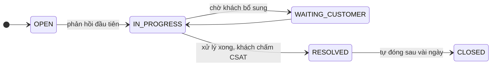
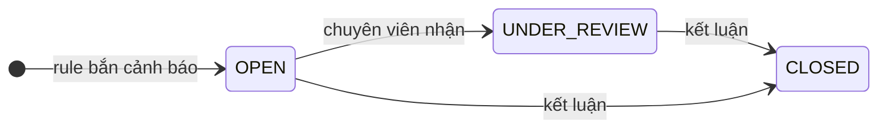

# 8. Chăm sóc khách hàng, tuân thủ và nội dung

Schema: `crm`, `compliance`, `content`. Ba schema này ít liên quan tới dòng tiền nhưng là nguồn dữ liệu chính cho các bài toán ML và LLM.

## 8.1. Chăm sóc khách hàng (`crm`)

### Ticket hỗ trợ

Khi khách gọi hotline, chat, gửi email hay phản hồi trên app, nhân viên hỗ trợ (`SUPPORT`) mở một **ticket** trong `crm.support_tickets`.

| Cột | Giá trị | Ghi chú |
|---|---|---|
| `channel` | `HOTLINE`, `LIVE_CHAT`, `EMAIL`, `APP_FEEDBACK`, `BRANCH` | Khách liên hệ qua đâu |
| `category` | `ACCOUNT_OPENING`, `LOGIN_OTP`, `DEPOSIT_WITHDRAWAL`, `ORDER_ISSUE`, `MARGIN`, `CORPORATE_ACTION`, `FEES`, `APP_BUG`, `COMPLAINT`, `OTHER` | Do nhân viên gán. Là **nhãn** cho bài phân loại văn bản |
| `priority` | `LOW` → `URGENT` | Khiếu nại và margin thường ưu tiên cao |
| `csat_score` | 1–5 | Điểm hài lòng khách chấm sau khi xử lý xong. Có thể `NULL` nếu khách không chấm |

Hai chỉ số vận hành phổ biến:

- **Thời gian phản hồi đầu tiên** = `first_response_at − opened_at`.
- **Thời gian xử lý** = `resolved_at − opened_at`.

`crm.ticket_messages` chứa nội dung hội thoại tiếng Việt, mỗi tin nhắn một dòng. `sender_type` là `CUSTOMER`, `AGENT` hoặc `BOT` (chatbot trả lời tự động ở kênh live chat).

### Ghi chú của RM

`crm.rm_notes` là ghi chú tự do RM viết sau mỗi cuộc gọi, buổi gặp, lần tư vấn (`note_type`). Dữ liệu này dùng cho bài tóm tắt và gợi ý tư vấn bằng LLM.

### Tín hiệu rời bỏ (churn)

Trước khi rời bỏ, khách thường để lại dấu hiệu ở nhiều bảng:

- Đăng nhập thưa dần (`oms.client_sessions`).
- Mở ticket khiếu nại, CSAT thấp (`crm.support_tickets`).
- Rút gần hết tiền (`ledger.cash_transactions`, `WITHDRAWAL`).
- Không đặt lệnh nữa (`oms.orders`).

Đây là ví dụ điển hình của bài toán cần **gộp đặc trưng từ cả hai DB**.

## 8.2. Tuân thủ và phòng chống rửa tiền (`compliance`)

### Rửa tiền là gì?

**Rửa tiền** là biến tiền bất hợp pháp thành tiền trông hợp pháp. Thường gồm ba giai đoạn:

1. **Sắp đặt (placement):** đưa tiền bẩn vào hệ thống tài chính, ví dụ nạp vào tài khoản chứng khoán.
2. **Phân tán (layering):** chuyển qua lại nhiều lần để xoá dấu vết.
3. **Hợp nhất (integration):** rút ra dưới dạng tiền "sạch".

Ngoài rửa tiền, CTCK còn phải giám sát **thao túng thị trường**: tạo cung cầu giả để đẩy giá.

CTCK có nghĩa vụ phát hiện và báo cáo các giao dịch đáng ngờ. Bộ phận tuân thủ (`COMPLIANCE`) chạy các **quy tắc** (rule) mỗi tối để sinh **cảnh báo** (alert), rồi chuyên viên xem xét từng cảnh báo.

### Các quy tắc (`compliance.aml_rules`)

| `rule_code` | Hành vi | Ngưỡng | Mức độ |
|---|---|---|---|
| `STRUCTURING` | Chia nhỏ khoản nạp để né ngưỡng báo cáo | ≥ 3 lần nạp trong ngày, mỗi lần 250 – dưới 300 triệu | HIGH |
| `LARGE_CASH` | Nạp tiền giá trị lớn | 1 lần nạp ≥ 1 tỷ | LOW |
| `RAPID_IN_OUT` | Nạp vào rồi rút ra ngay, không giao dịch | Nạp ≥ 500 triệu, rút ≥ 90% trong 2 ngày, không có giao dịch | HIGH |
| `SHARED_DEVICE` | Nhiều khách dùng chung một thiết bị | 1 thiết bị đăng nhập > 3 khách trong 30 ngày | MEDIUM |
| `SPOOFING` | Đặt lệnh rồi huỷ rất nhanh để tạo cung cầu giả | > 20 lệnh bị huỷ trong 5 giây sau khi đặt, trong 1 ngày | HIGH |
| `WASH_TRADE` | Các tài khoản liên quan mua bán qua lại với nhau | Tài khoản dùng chung thiết bị mua và bán cùng mã trong 5 phút, ≥ 3 lần/ngày | HIGH |

Để ý các rule dùng dữ liệu ở **cả hai DB**: `STRUCTURING` và `RAPID_IN_OUT` dùng `ledger.cash_transactions` (PG), `SPOOFING` dùng `oms.order_events` (MySQL), `SHARED_DEVICE` và `WASH_TRADE` dùng `oms.client_sessions` kết hợp `oms.executions`.

### Cảnh báo (`compliance.aml_alerts`)

Khi đóng, chuyên viên ghi **kết luận** (`disposition`):

- `TRUE_POSITIVE`: đúng là đáng ngờ, lập báo cáo.
- `FALSE_POSITIVE`: báo nhầm, khách có lý do hợp lý.
- `INCONCLUSIVE`: chưa đủ căn cứ, tiếp tục theo dõi.

`details` (jsonb) chứa bằng chứng riêng của từng rule, ví dụ `{"deposits": [...], "count": 3}`. `score` là điểm rủi ro.

### Nhãn có nhiễu và ground truth

`disposition` là nhãn do **con người** kết luận, nên **có sai sót**: bỏ sót kẻ gian, kết luận nhầm người ngay. Generator cố ý tạo nhiễu như vậy. Ngoài ra:

- Có những kẻ gian **né được rule** (ví dụ ngày đầu chỉ nạp 2 lần thay vì 3), nên không có alert nào.
- `LARGE_CASH` bắn rất nhiều vào khách giàu bình thường, phần lớn là báo nhầm.

**Sự thật** (ai thật sự gian lận) nằm ở file ground truth ngoài DB, không nằm trong DB, giống như CTCK thật không bao giờ biết chắc. Khi làm ML, hãy coi `disposition` là nhãn huấn luyện có nhiễu, và dùng ground truth để đánh giá cuối cùng.

> **Trong generator:** cùng một rule với cùng một khách không bắn lại trong 30 ngày (trừ `LARGE_CASH`). Cảnh báo được xem xét sau 1–8 ngày làm việc.

## 8.3. Nội dung văn bản (`content`)

| Bảng | Là gì | Dùng cho |
|---|---|---|
| `news_articles` + `article_instruments` | Tin tức thị trường, tin doanh nghiệp. Một tin có thể nhắc nhiều mã | Phân tích cảm xúc (sentiment), tác động của tin lên giá |
| `disclosures` | **Công bố thông tin** chính thức của doanh nghiệp: BCTC, chia cổ tức, nghị quyết, thay đổi nhân sự, giao dịch nội bộ | Trích xuất thông tin, đối chiếu với `corp_action.events` qua `ca_event_id` |
| `research_reports` | Báo cáo phân tích của chuyên viên ZSC (`ANALYST`): khuyến nghị và giá mục tiêu | Tóm tắt, hỏi đáp |
| `product_documents` | Điều khoản, FAQ, biểu phí, chính sách margin, hướng dẫn sử dụng | Chatbot RAG cho khách hàng |

**Khuyến nghị** trong báo cáo phân tích, từ tích cực đến tiêu cực: `BUY` (mua) → `OUTPERFORM` (khả quan hơn thị trường) → `HOLD` (nắm giữ) → `UNDERPERFORM` (kém hơn thị trường) → `SELL` (bán).

**Tin tức và giá liên quan với nhau.** Generator chọn trước cảm xúc của tin (tích cực / tiêu cực / trung tính), tạo cú sốc giá tương ứng cho mã đó trong ngày, rồi mới viết tin. Cảm xúc thật được lưu ở ground truth để chấm mô hình sentiment.

---

← [7. Quyền cổ đông](07-quyen-co-dong.md) · Tiếp theo: [9. Một ngày giao dịch →](09-mot-ngay-giao-dich.md)
