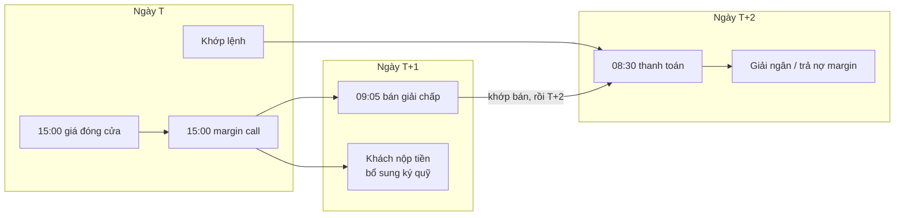

# 9. Một ngày giao dịch

Bài này ghép mọi thứ ở các bài trước lên một trục thời gian: **trong một ngày giao dịch, việc gì xảy ra lúc mấy giờ, ghi vào bảng nào**. Đây là bức tranh bạn cần khi thiết kế pipeline streaming: biết lúc nào dữ liệu dồn dập, lúc nào yên tĩnh, và sự kiện nào phụ thuộc sự kiện nào.

Giờ dưới đây là **giờ Việt Nam**, theo lịch generator chạy.

## 9.1. Dòng thời gian

| Giờ | Việc | Bảng được ghi |
|---|---|---|
| **07:00** | Mở ngày: tính giá tham chiếu, trần, sàn cho mọi mã. Điều chỉnh giá nếu hôm nay là ngày GDKHQ | (trong bộ nhớ; ghi vào `eod_prices` lúc 15:00) |
| 07:05 – 07:50 | Tin tức doanh nghiệp đầu ngày (có thể gây cú sốc giá) | `content.news_articles`, `article_instruments` |
| 07:00 – 22:00 | Khách đăng nhập rải rác cả ngày | `oms.client_sessions` |
| **08:00** | Thực hiện quyền: tạo entitlements nếu hôm nay là ngày chốt; chi trả nếu là ngày thanh toán | `corp_action.*`, `ledger.*`, `custody.*` |
| 08:15 | *(Chỉ ngày giao dịch đầu tháng)* Thu lãi margin tháng trước | `ledger.cash_transactions` (`MARGIN_INTEREST`), `ledger.cash_balances`, `margin.loans` |
| **08:30** | **Thanh toán T+2** các giao dịch khớp 2 ngày làm việc trước. Giải ngân margin, tự động trả nợ | `custody.settlement_instructions`, `ledger.*`, `custody.*`, `margin.loans` |
| 08:00 – 17:00 | Nạp / rút tiền | `ledger.cash_transactions`, `ledger.cash_balances` |
| 08:00 – 22:00 | Ticket hỗ trợ, tin nhắn | `crm.support_tickets`, `crm.ticket_messages` |
| **09:00 – 09:15** | Phiên ATO: nhận lệnh, chưa khớp | `oms.orders`, `oms.order_events`, `ledger.cash_balances`, `custody.positions` |
| 09:05 | Đặt lệnh **bán giải chấp** cho các call margin đã quá ngưỡng | `oms.orders` (source `SYSTEM`) |
| 09:15 | Khớp ATO một lần | `oms.executions`, `custody.settlement_instructions`, … |
| **09:15 – 11:30** | **Khớp liên tục buổi sáng**. Cao điểm đầu phiên | toàn bộ nhóm bảng giao dịch |
| 11:30 – 13:00 | Nghỉ trưa | (yên tĩnh) |
| **13:00 – 14:30** | Khớp liên tục buổi chiều. Dồn dập dần về cuối | toàn bộ nhóm bảng giao dịch |
| 14:30 – 14:45 | Phiên ATC: nhận lệnh | `oms.orders`, … |
| 14:45 | Khớp ATC, xác định **giá đóng cửa** | `oms.executions`, … |
| **15:00** | **Đóng phiên:** huỷ hết lệnh còn mở (`EXPIRED`); ghi giá cuối ngày; NAV quỹ; tính lãi ngày; **kiểm tra tỷ lệ ký quỹ**; báo cáo phân tích | `oms.orders`, `oms.order_events`, `product.eod_prices`, `product.fund_navs`, `margin.interest_accruals`, `margin.margin_calls`, `content.research_reports` |
| 15:30 | Bản tin tổng kết thị trường | `content.news_articles` |
| 17:00 | Công bố sự kiện quyền mới | `corp_action.events`, `content.disclosures` |
| 18:00 – 19:00 | Công bố báo cáo tài chính | `content.disclosures` |
| **23:00** | **Chạy quy tắc AML** trên dữ liệu cả ngày | `compliance.aml_alerts` |
| 23:59 | Kết thúc ngày, chuyển sang ngày giao dịch kế tiếp | |

Trong chế độ `live`, generator còn bắn **một tick giá mỗi phút cho mỗi mã** vào Kafka topic `marketdata.ticks` trong giờ khớp liên tục, và sự kiện xem mã vào `app.clickstream` mỗi khi khách đăng nhập.

## 9.2. Nhịp trong ngày

```
Số lệnh
  ▲
  █                                                      █
  █ █                                                  █ █
  █ █ █                                             █  █ █
  █ █ █ █ ▄ ▄ ▄ ▄                       ▄ ▄ ▄ ▄ █ █ █  █ █
──┴─┴─┴─┴─┴─┴─┴─┴───── nghỉ trưa ─────┴─┴─┴─┴─┴─┴─┴──┴─┴──►
 9:00   9:15        11:30          13:00            14:30 14:45
 ATO                                                 ATC
```

Lượng lệnh có **hình chữ U**: dồn vào đầu phiên sáng và cuối phiên chiều, thưa vào giữa phiên. Trong generator, khoảng 12% lệnh rơi vào phiên ATO, 28% vào giờ đầu tiên của phiên liên tục, 18% vào 45 phút trước ATC và 12% vào phiên ATC.

Ngoài ra, khối lượng còn tăng mạnh vào **ngày có tin tức** và **ngày thị trường biến động mạnh**.

## 9.3. Chuỗi phụ thuộc giữa các ngày

Nhiều việc trong ngày hôm nay là hệ quả của những ngày trước:



Hệ quả cho streaming:

- **Join có độ trễ lớn:** `executions` (ngày T) và `settlement_instructions` chuyển sang `SETTLED` (ngày T+2) cách nhau 2–4 ngày lịch. Window join phải đủ rộng, hoặc dùng state không giới hạn thời gian.
- **Sự kiện theo lô:** thanh toán, thực hiện quyền, kiểm tra margin, AML đều chạy theo lô vào giờ cố định. Lúc đó CDC sinh ra một "đợt sóng" event trong vài giây.
- **Sự kiện liên tục:** lệnh, khớp, tick giá diễn ra liên tục trong giờ giao dịch.

## 9.4. Bảng nào "nóng", bảng nào "lạnh"?

| Mức | Bảng | Đặc điểm ghi |
|---|---|---|
| **Rất nóng** | `oms.orders`, `oms.order_events`, `oms.executions`, `ledger.cash_balances`, `custody.positions`, topic `marketdata.ticks` | Liên tục trong giờ giao dịch, đỉnh vào ATO/ATC |
| Nóng | `custody.settlement_instructions`, `ledger.cash_transactions`, `custody.position_movements`, `oms.client_sessions` | Liên tục + các đợt lô (08:30) |
| Theo ngày | `product.eod_prices`, `product.fund_navs`, `margin.interest_accruals`, `margin.margin_calls`, `compliance.aml_alerts` | Một đợt mỗi ngày |
| Thỉnh thoảng | `customer.*`, `account.accounts`, `corp_action.*`, `crm.*`, `content.*` | Rải rác |
| Gần như tĩnh | `ref.*`, `product.instruments`, `product.issuers`, `product.fee_schedules`, `margin.loan_products`, `compliance.aml_rules` | Nạp một lần, hiếm khi đổi |

Bảng "gần như tĩnh" là ứng viên cho **GlobalKTable / broadcast state** khi enrich stream. Bảng "rất nóng" cần chọn **key** cẩn thận (`account_id`, `instrument_id`, `order_id`) để phân vùng và giữ thứ tự sự kiện.

## 9.5. Lưu ý múi giờ

| Loại cột | Lưu theo | Ví dụ |
|---|---|---|
| Timestamp PG (`timestamptz`) | UTC, có múi giờ | `2025-06-16 02:20:01+00` = 09:20:01 giờ VN |
| Timestamp MySQL (`DATETIME(6)`) | UTC, **không** ghi múi giờ | `2025-06-16 02:20:01.000000` = 09:20:01 giờ VN |
| Ngày nghiệp vụ (`trade_date`, `value_date`, `settle_date`, `call_date`…) | Giờ Việt Nam | `2025-06-16` |

Hai bẫy thường gặp:

1. **Lọc theo ngày bằng timestamp.** Trong MySQL, `WHERE created_at >= '2025-06-16'` là từ **07:00 sáng** giờ VN, không phải nửa đêm. Muốn lọc theo ngày giao dịch, dùng `trade_date`. Muốn nhóm theo giờ VN, cộng 7 tiếng: `HOUR(created_at + INTERVAL 7 HOUR)`.
2. **PostgreSQL.** Viết rõ múi giờ trong literal: `opened_at >= TIMESTAMPTZ '2025-06-01 00:00+07'`. Bộ câu hỏi text2sql dùng đúng cách này.

---

← [8. CSKH, tuân thủ và nội dung](08-cskh-tuan-thu-noi-dung.md) · Tiếp theo: [10. Từ điển thuật ngữ →](10-thuat-ngu.md)
