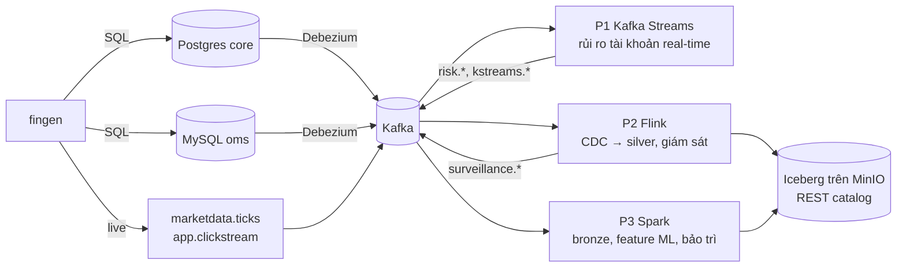

# Plan: 3 luồng streaming trên lakehouse

Có 3 luồng: Kafka Streams, Flink và Spark Structured Streaming. Đầu vào là dữ liệu CDC của bộ dataset công ty chứng khoán ([dataset/](../dataset/README.md), generator ở [dataset/generator/](../dataset/generator/README.md)). Đầu ra là Kafka và lakehouse Iceberg trên MinIO.

## 0. Bức tranh tổng thể



Mỗi engine nhận đúng loại việc nó làm tốt nhất trong một kiến trúc thật. Ngoài ra, cả ba cùng làm thêm một bài đối chứng (`trade_stats_1m`, mục 1.5) để so sánh trực tiếp.

| Luồng | Vai trò nghiệp vụ | Vì sao chọn engine này | Đầu ra |
|---|---|---|---|
| **P1 Kafka Streams** | Tính tỷ lệ ký quỹ từng tài khoản theo giá real-time, cảnh báo sớm trước giờ chốt cuối ngày | Thư viện nhúng trong một service, state cục bộ, join KTable, độ trễ thấp, exactly-once trong Kafka | Topic `risk.account_exposure`, `risk.margin_alerts` |
| **P2 Flink** | Phản chiếu dữ liệu OLTP vào lakehouse (silver); phát hiện spoofing ngay trong phiên | Hiểu changelog của CDC một cách tự nhiên (`debezium-json`), upsert vào Iceberg, CEP (`MATCH_RECOGNIZE`), event time chuẩn | `silver.*`, `gold.executions_enriched`, topic `surveillance.alerts` |
| **P3 Spark** | Lưu toàn bộ topic vào bronze; tính feature khách hàng cho ML; bảo trì bảng Iceberg | Micro-batch + `MERGE INTO`, xử lý batch và stream chung một API, procedure bảo trì Iceberg, gần với ML | `bronze.kafka_events`, `gold.customer_daily_features` |

Thứ tự làm: **Phase 0 → P1 → P2 → P3 → So sánh**.
- P1 chỉ cần Kafka.
- P2 bắt đầu ghi Iceberg.
- P3 đọc bảng do P2 ghi và làm compaction cho chúng.

---

## 1. Phase 0: nền chung

### 1.1 Nạp dataset đúng thứ tự

Generator chưa được chạy trên stack. Thứ tự dưới đây quan trọng, vì backfill sẽ đổ khoảng 3 triệu event qua CDC: connector phải được cấu hình xong **trước** khi backfill.

1. **Kafka cần volume.** Hiện Kafka không gắn volume, nên tạo lại container là mất topic và cả offset của connector. Gắn volume cho `/var/lib/kafka/data` (đặt `KAFKA_LOG_DIRS`) trước khi nạp dữ liệu lớn.
2. **Tạo schema:** `bash dataset/scripts/init_db.sh`.
3. **Cập nhật 2 connector** bằng `PUT /connectors/<name>/config`, thêm các thuộc tính sau vào config hiện có:

   ```json
   "decimal.handling.mode": "string",
   "key.converter": "org.apache.kafka.connect.json.JsonConverter",
   "key.converter.schemas.enable": "false",
   "value.converter": "org.apache.kafka.connect.json.JsonConverter",
   "value.converter.schemas.enable": "false",
   "topic.creation.default.partitions": "3",
   "topic.creation.default.replication.factor": "1"
   ```

   Thêm riêng cho từng connector:
   - **MySQL:** `"database.include.list": "appdb,oms"`.
   - **Postgres:** `"heartbeat.interval.ms": "10000"`, để slot vẫn tiến lên khi các bảng không có thay đổi.

   Lý do của từng thay đổi:
   - **`decimal.handling.mode=string`:** mặc định Debezium mã hoá `NUMERIC`/`DECIMAL` thành bytes base64, engine nào đọc cũng khổ.
   - **Bỏ schema trong JSON:** message gọn hơn khoảng 5 lần. Avro và Schema Registry để đợt tuning.
   - **3 partition:** đủ để chạy song song và thử scale. Kafka Streams cũng cần các topic đem join có cùng số partition.
4. **Backfill:** `python -m fingen backfill --preset S`. Theo dõi lag của connector trên kafka-ui.
5. **Khi phát triển pipeline:** chạy `python -m fingen live --speed 60`. Với tốc độ này, một phiên giao dịch mất khoảng 6 phút.

**Xong khi:**
- Có các topic `mysql.oms.*` và `pg.<schema>.<table>`.
- Message của `mysql.oms.executions` có `after.matched_price` dạng chuỗi số và không còn khối `schema`.
- `marketdata.ticks` có dữ liệu khi chạy `live`.

### 1.2 Hợp đồng dữ liệu

Chi tiết từng topic (key, kiểu ghi, cột event time, lưu lượng) nằm ở [generator README, mục 3](../dataset/generator/README.md#3-bản-đồ-sự-kiện). Tất cả pipeline tuân theo 4 quy tắc:

1. **Event time** là cột nghiệp vụ (`matched_at`, `event_time`, `created_at`…), **không phải** `source.ts_ms`. Khi backfill, Debezium thấy cả ngày mô phỏng được commit cùng lúc ở thời gian thật.
2. **Envelope Debezium:** dùng `op` (`c`/`u`/`d`/`r`) và `after`. Với delete thì dùng `before`. `r` là bản ghi snapshot, xử lý như insert. Sau mỗi delete còn có một tombstone (value `null`).
3. **Bảng snapshot** (`orders`, `cash_balances`, `positions`, `loans`…) là upsert theo khoá. Thứ tự chỉ được đảm bảo trong cùng một partition. Khi cần loại bản cũ, so cột `version`.
4. **Ngày nghiệp vụ** tính theo giờ Việt Nam (UTC+7). Mọi timestamp trong topic và trong Iceberg đều là UTC.

Debezium (mặc định) chuyển kiểu dữ liệu như sau. **Hãy mở một message thật trên kafka-ui để xác nhận trước khi viết parser.**

| Kiểu nguồn | Trong JSON | Cách chuyển |
|---|---|---|
| PG `numeric`, MySQL `DECIMAL` | chuỗi `"25350.0000"` | cast sang decimal |
| PG `timestamptz` | chuỗi ISO-8601 UTC | parse thành timestamp |
| MySQL `DATETIME(6)` | số nguyên epoch **micro giây** | `/1000` thành millis |
| PG/MySQL `date` | số ngày kể từ 1970-01-01 | cộng vào epoch |
| MySQL `BOOLEAN` (`tinyint(1)`) | có thể là `true/false` hoặc `0/1` | kiểm tra message thật |
| PG `jsonb` | chuỗi JSON | parse lần nữa |

### 1.3 Quy ước lakehouse

- **Catalog:** tên `lakehouse`, kiểu REST, `http://iceberg-rest:8181`. Thông số S3 xem trong [README chính](../README.md#lakehouse-minio--iceberg-rest-catalog).
- **Namespace và người ghi.** Mỗi bảng chỉ có **một engine được ghi** để tránh xung đột commit. Riêng job bảo trì của Spark được phép rewrite.

| Namespace | Nội dung | Người ghi |
|---|---|---|
| `bronze` | Event thô từ Kafka, chỉ append, phát lại được | P3 Spark |
| `silver` | Bản phản chiếu bảng OLTP (upsert, Iceberg v2) | P2 Flink |
| `gold` | Bảng nghiệp vụ, đặt hậu tố `_flink` / `_spark` khi trùng bài | P2, P3 |

- **Tên bảng:** `<nguồn>_<schema>_<bảng>`, ví dụ `silver.oms_orders`, `silver.ledger_cash_balances`.
- **Checkpoint/state:** `s3://warehouse/_checkpoints/<engine>/<job>`. Key `lakehouse` chỉ được phép trên bucket `warehouse` nên phải đặt ở đây.
- **Partition:** bảng sự kiện dùng `days(<event_ts>)`; bảng lớn upsert theo id dùng `bucket(16, <id>)`.
- **Phiên bản Iceberg phía client:** giữ cùng dòng 1.10.x với catalog (1.10.1).

### 1.4 Hạ tầng, phiên bản, tài nguyên

Mỗi luồng là một `profile` trong `docker-compose.yml` (không tách file override), bật bằng `docker compose --profile flink up -d`.

| Luồng | Phiên bản đề xuất (đã kiểm tra có trên Maven Central) | RAM ước tính |
|---|---|---|
| Nền hiện tại (DB, Kafka, Connect, UI, MinIO, catalog) | | ~3,7 GB |
| P1 | Java 21, `kafka-streams` 4.3.2 (cùng bản với broker) | ~0,5 GB |
| P2 | Flink 1.20 (LTS) + `flink-sql-connector-kafka` 3.4.0-1.20 + `iceberg-flink-runtime-1.20` 1.10.1 + `iceberg-aws-bundle` 1.10.1 | ~2,5 GB (JobManager 1 GB + TaskManager 1,5 GB) |
| P3 | Spark 3.5.x + `spark-sql-kafka-0-10_2.12` 3.5.x + `iceberg-spark-runtime-3.5_2.12` 1.10.1 + `iceberg-aws-bundle` | ~3 GB (`local[*]`) |

Docker có 15,5 GB nên chạy được cả ba cùng lúc, nhưng khi phát triển chỉ nên bật luồng đang làm.

```
consumers/
├── PLAN.md
├── common/            # script đối soát, SQL "sự thật" cho từng bài
├── kafka-streams/     # Gradle project + Dockerfile
├── flink/             # Dockerfile (image + jar), sql/*.sql, conf/
└── spark/             # Dockerfile, jobs/*.py, maintenance/*.py
```

### 1.5 Bài đối chứng chung: `trade_stats_1m`

Cả ba engine cài **cùng một định nghĩa** để so sánh kết quả và hành vi:

- **Đầu vào:** `mysql.oms.executions`. Đây là bảng chỉ insert, nên là bài sạch nhất để so.
- **Nhóm:** `symbol` × cửa sổ tumbling 1 phút theo `matched_at` (event time).
- **Chỉ số:** `trade_count`, `volume` = Σ`matched_quantity`, `value` = Σ`matched_value`, `vwap` = value/volume, `high`, `low`.
- **Dữ liệu trễ:** chấp nhận trễ 30 giây. Chỉ phát kết quả **một lần**, khi cửa sổ đóng.
- **Đầu ra:**
  - Topic `<engine>.trade_stats_1m`, key `symbol|window_start`.
  - Bảng `gold.trade_stats_1m_<engine>`. Riêng Kafka Streams không ghi Iceberg; topic của nó được P3 đưa vào bronze.
- **Sự thật để đối soát:** câu SQL `GROUP BY` trên MySQL, có sẵn ở [generator README, mục 7](../dataset/generator/README.md#7-ground-truth-và-đối-soát).
- **Script** `consumers/common/reconcile_trade_stats.py`: so từng cặp (symbol, phút) giữa SQL và output của mỗi engine, in số dòng lệch.

---

## 2. P1: Kafka Streams, dịch vụ rủi ro tài khoản real-time

**Bài toán.** Generator chỉ kiểm tra tỷ lệ ký quỹ lúc 15:00, theo giá đóng cửa. Service này tính lại tỷ lệ mỗi khi giá hoặc vị thế thay đổi, nên phát hiện tài khoản sắp bị call **ngay trong phiên**.

### Đầu vào

| Topic | Dạng | Ghi chú |
|---|---|---|
| `marketdata.ticks` | KStream → KTable giá cuối theo `instrument_id` | Chỉ có khi chạy `live` |
| `pg.product.eod_prices` | KTable giá đóng cửa | Giá dự phòng khi chưa có tick (backfill) |
| `pg.custody.positions` | KTable, key `account_id`+`instrument_id` | |
| `pg.ledger.cash_balances` | KTable, key `account_id` | |
| `pg.margin.loans` | KTable → tổng dư nợ theo `account_id` | Chỉ lấy `ACTIVE`/`OVERDUE` |
| `pg.account.accounts`, `pg.margin.loan_products` | GlobalKTable | Ngưỡng `maintenance` / `force_sell` |
| `mysql.oms.executions` | KStream | Cho bài đối chứng |

### Topology

1. **Serde cho envelope Debezium:** chuyển thành Java record. Tombstone và `op=d` trở thành `null`, tức là xoá khỏi KTable. Đặt `TimestampExtractor` đọc cột nghiệp vụ.
2. **Giá cuối:** đổi key của ticks sang `instrument_id`, rồi `toTable()`.
3. **Giá trị vị thế:** foreign-key join `positions` → `last_price` theo `instrument_id` (Kafka Streams hỗ trợ FK join giữa hai KTable), cho ra `total_quantity × price`.
4. **Tổng theo tài khoản:** `groupBy(account_id).aggregate(adder, subtractor)` cho ra giá trị chứng khoán của từng tài khoản. Phải có `subtractor`, vì khi một vị thế đổi giá, KTable gửi cả bản cũ lẫn bản mới.
5. **Ghép tài khoản:** join giá trị chứng khoán ⋈ `cash_balances` ⋈ dư nợ theo `account_id`, cho ra `AccountRisk{assets, debt, equity, ratio}`. Sau đó join GlobalKTable để lấy ngưỡng.
6. **Đầu ra:**
   - `risk.account_exposure`: topic compacted, mỗi tài khoản một bản ghi.
   - `risk.margin_alerts`: chỉ phát khi **mức** của tài khoản thay đổi (`OK` → `CALL` → `FORCE_SELL` và ngược lại). Mức trước đó lưu trong state store qua `processValues`.
7. **Đối chứng:** `executions` → `groupBy(symbol)` → `windowedBy(TimeWindows.ofSizeAndGrace(1 phút, 30 giây))` → `aggregate` → `suppress(untilWindowCloses)` → `kstreams.trade_stats_1m`.

### Cấu hình chính

- `processing.guarantee=exactly_once_v2`.
- `application.id=risk-service`.
- `state.dir` gắn vào volume.
- Endpoint HTTP `/health` trả về trạng thái `KafkaStreams.State`, dùng làm healthcheck của compose.
- Tuỳ chọn: endpoint Interactive Query `GET /accounts/{id}/risk` đọc thẳng từ state store.

### Kiểm chứng

- `reconcile_trade_stats.py` báo 0 dòng lệch so với SQL.
- **Cảnh báo sớm:**
  - Mọi tài khoản có `margin.margin_calls` trong ngày phải đã có alert `CALL` trước 15:00. Đo thời gian báo trước (lead time).
  - Ngày điều chỉnh thị trường lấy từ ground truth `injected_patterns` (`MARKET_CORRECTION`).
- **Kill rồi start lại service:** state phải được khôi phục từ changelog, không có output trùng.

### Bài tập vận hành

- Chạy 2 instance để quan sát rebalance và phân chia partition.
- Dùng `kafka-streams-application-reset` để xử lý lại từ đầu.
- Đổi định nghĩa của aggregate rồi xem các topic repartition/changelog được tạo lại thế nào.

**Xong khi:** service healthy; 2 topic `risk.*` có dữ liệu trong `live`; đối chứng đạt; có số đo lead time.

---

## 3. P2: Flink, CDC → silver Iceberg + giám sát giao dịch

### Hạ tầng

- Các service: `flink-jobmanager`, `flink-taskmanager`, thêm `flink-sql-gateway` nếu muốn submit SQL qua REST.
- Image tự build từ `flink:1.20`, thêm các jar ở mục 1.4 và Hadoop client jars. Iceberg trên Flink vẫn cần class `org.apache.hadoop.conf.Configuration` dù dùng S3FileIO; thiếu sẽ gặp `ClassNotFoundException`.
- Checkpoint: state backend RocksDB, mỗi 60 giây, lưu ở `s3://warehouse/_checkpoints/flink`. Cần plugin `flink-s3-fs-hadoop`, cấu hình endpoint MinIO và path-style.
- **Sink Iceberg commit theo checkpoint:** độ trễ dữ liệu xuất hiện trong silver ≈ chu kỳ checkpoint.

### Job (viết bằng Flink SQL trước)

**3.1 Silver mirror.**
- Mỗi bảng nguồn khai báo `'format' = 'debezium-json'`, rồi `INSERT INTO lakehouse.silver.<bảng>`.
- Bảng đích là Iceberg v2: `PRIMARY KEY (...) NOT ENFORCED`, `'format-version'='2'`, `'write.upsert.enabled'='true'`.
- Bảng cần phản chiếu:
  - MySQL: `oms.orders`, `oms.executions`.
  - Postgres: `ledger.cash_balances`, `custody.positions`, `margin.loans`, `account.accounts`, `customer.customers`, `product.instruments`.
- **Postgres cần `REPLICA IDENTITY FULL`.** `debezium-json` cần trường `before` của event update. Nếu thiếu, job dừng với lỗi gợi ý đúng chuyện này. `init_db.sh` mới đặt FULL cho 3 bảng; bổ sung cho các bảng còn lại trong danh sách. Đổi lại, WAL sẽ to hơn.
- **Kiểu dữ liệu:** khai báo kiểu thô ở bảng source (`STRING`, `BIGINT`, `INT`), chuyển trong view. Ví dụ:
  - Micro giây → `TO_TIMESTAMP_LTZ(col / 1000, 3)`.
  - Số ngày → `TO_DATE(FROM_UNIXTIME(col * 86400))`, kèm `table.local-time-zone = 'UTC'`.
  - Decimal → `CAST(col AS DECIMAL(20,2))`.

**3.2 Làm giàu khớp lệnh.**
- `executions` join theo thời gian (`FOR SYSTEM_TIME AS OF matched_at`) với `instruments` và `accounts → customers`, dùng bảng versioned dựng từ CDC.
- Ghi vào `gold.executions_enriched` (append, partition theo `days(matched_at)`).

**3.3 Giám sát spoofing.**
- Dùng `MATCH_RECOGNIZE` trên `mysql.oms.order_events`, phân vùng theo order: `SUBMITTED` rồi `CANCELLED` trong vòng 5 giây.
- Đếm theo tài khoản và ngày; khi vượt 20 thì phát `surveillance.alerts` và ghi `gold.surveillance_alerts`.
- So với rule cuối ngày (`compliance.aml_alerts`, rule `SPOOFING`, chạy lúc 23:00) và ground truth để đo precision/recall và độ sớm.

**3.4 Đối chứng.**
- Dùng `TUMBLE` TVF với `WATERMARK FOR matched_at AS matched_at - INTERVAL '30' SECOND`.
- Ghi vào topic `flink.trade_stats_1m` và bảng `gold.trade_stats_1m_flink`.

### Kiểm chứng

- **Silver khớp nguồn:** sau khi dừng generator, so `count(*)` và `sum` của cột tiền theo ngày giữa silver và DB nguồn. Lệch bằng 0.
- **Spoofing:** bắt được các ngày spoofing trong ground truth. Báo cáo số bỏ sót và số báo nhầm.
- **Khôi phục:** kill TaskManager thì job tự phục hồi từ checkpoint. Thử nâng cấp job bằng savepoint.

### Lưu ý

- **Nhiều file nhỏ và equality delete:** đọc silver sẽ chậm dần. Đây là lý do P3 có job compaction.
- **Ghi đồng thời:** compaction chạy song song với upsert của Flink có thể xung đột commit. Bật `partial-progress`, hoặc chạy compaction lúc job tạm dừng.

**Xong khi:** 8 bảng silver khớp nguồn; spoofing được phát hiện trong phiên; đối chứng đạt; khôi phục từ checkpoint thành công.

---

## 4. P3: Spark Structured Streaming, bronze + feature + bảo trì

### Hạ tầng

- Một container `spark` (image `apache/spark:3.5.x` có Python), chạy `spark-submit --master local[*]` với các package ở mục 1.4.
- Spark UI ở cổng 4040.
- Mỗi query có checkpoint riêng ở `s3://warehouse/_checkpoints/spark/<job>`.

### Job (PySpark)

**4.1 `bronze_ingest`.**
- `subscribePattern` lấy mọi topic nghiệp vụ: `pg\..*`, `mysql\.oms\..*`, `marketdata\..*`, `app\..*`, `risk\..*`, `surveillance\..*`, `.*trade_stats_1m`.
- Ghi vào `bronze.kafka_events` với các cột `topic, partition, offset, key, value, kafka_ts, ingest_ts`, partition theo `topic` và `days(kafka_ts)`.
- Trigger mỗi 1 phút.
- Bronze là lịch sử phát lại được của mọi topic. Retention của Kafka thì có hạn.

**4.2 `customer_daily_features`.**
- Đọc Kafka: `orders`, `order_events`, `executions`, `cash_transactions`, `client_sessions`.
- Tính feature theo `(customer_id, business_date)`:
  - số lệnh, tỷ lệ huỷ, tỷ lệ bị từ chối;
  - giá trị khớp mua và bán;
  - số lần huỷ nhanh;
  - số lần đăng nhập, số thiết bị;
  - tổng nạp, tổng rút, số lần nạp trong khoảng 250–300 triệu.
- Ghi bằng `foreachBatch` + `MERGE INTO gold.customer_daily_features`. Feature của một ngày được cập nhật dần trong ngày.
- **Trong một micro-batch, mỗi khoá chỉ được giữ một dòng** trước khi MERGE (`row_number()` theo `version` / event time). Nếu không, MERGE sẽ lỗi.
- Bảng chiều `accounts → customer_id` đọc dạng tĩnh từ `silver.account_accounts` và đọc lại ở mỗi batch.

**4.3 Đối chứng.**
- `withWatermark("matched_at", "30 seconds")` + `groupBy(window, symbol)`, `outputMode("append")`.
- Ghi `gold.trade_stats_1m_spark` và topic `spark.trade_stats_1m`.

**4.4 Bảo trì Iceberg (batch, chạy tay hoặc theo lịch).**
- Procedure: `rewrite_data_files`, `rewrite_position_delete_files`, `expire_snapshots`, `remove_orphan_files`, `rewrite_manifests`.
- Áp dụng cho `silver.*` (do Flink ghi) và `bronze.*`.
- Đo trước và sau: số file, số snapshot, thời gian một câu đọc.

**4.5 Bàn giao cho ML.** Notebook ghép `gold.customer_daily_features` với `ground_truth/customer_hidden_profile.parquet` để tạo tập huấn luyện cho churn và AML.

### Kiểm chứng

- Với mỗi partition, offset lớn nhất trong bronze bằng end offset của topic, sau khi generator đã dừng.
- Feature của vài khách khớp với SQL tính trực tiếp trên DB.
- Đối chứng đạt.
- Compaction giảm số file mà không đổi kết quả đọc.

### Lưu ý

- **Spark không đọc stream được từ bảng Iceberg upsert:** stream Iceberg chỉ hỗ trợ snapshot append. Vì vậy gold đọc Kafka chứ không đọc silver.
- **Micro-batch tạo nhiều file nhỏ:** cân bằng giữa trigger interval và độ trễ.

**Xong khi:** bronze đủ và khớp offset; bảng feature cập nhật trong `live`; bảo trì chạy được trên bảng của Flink; đối chứng đạt.

---

## 5. So sánh và tổng kết

Chạy cùng một kịch bản: reset → backfill `S` → `live --speed 60` trong 2 phiên. Ghi kết quả vào bảng trong `consumers/README.md`:

| Tiêu chí | Cách đo |
|---|---|
| Đúng | Số dòng lệch của `trade_stats_1m` so với SQL |
| Độ trễ | Từ lúc cửa sổ đóng (theo event time) đến lúc kết quả có trên topic/bảng |
| Khôi phục | Kill giữa phiên: có mất hoặc trùng dữ liệu không, mất bao lâu để chạy lại |
| Dữ liệu trễ | Đưa vào vài execution trễ 10 giây và 2 phút (viết một script injector nhỏ), xem mỗi engine xử lý thế nào |
| Vận hành | Số service, cách deploy, cách nâng cấp logic (savepoint / application reset / checkpoint mới) |
| Tài nguyên | RAM và CPU trung bình từ `docker stats` |

## 6. Rủi ro chung

- **Aiven free tier tự ngủ:** commit Iceberg sẽ lỗi. Job Flink sẽ restart liên tục, batch Spark thì fail. Kiểm tra service Aiven trước khi chạy.
- **Đĩa:** backfill `S` tạo vài GB trên Kafka. Đặt retention cho topic, và có bronze rồi thì không cần giữ lâu.
- **Reset toàn bộ:** reset generator **không** xoá được dữ liệu đã nằm trong Kafka, Iceberg hay state của các engine. Làm đúng quy trình ở [generator README, mục 8](../dataset/generator/README.md#8-reset-và-phát-lại-toàn-bộ).
- **Lệch múi giờ:** ngày nghiệp vụ tính theo UTC+7. Chia ngày theo UTC sẽ dồn sai các sự kiện từ 00:00 đến 07:00 giờ Việt Nam.
