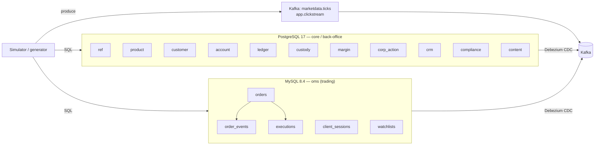
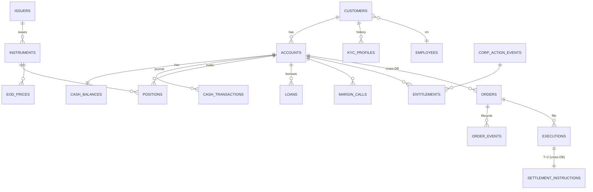

# Dataset: Công ty chứng khoán giả lập (Securities Brokerage)

Bộ dữ liệu mô phỏng hệ thống của một **công ty chứng khoán (CTCK) tại Việt Nam**. Bộ dữ liệu phục vụ ba nhóm việc:

1. **Nguồn OLTP chuẩn hoá** cho CDC → Kafka → Kafka Streams / Flink / Spark.
2. **Dữ liệu có nhãn** cho các bài toán ML: AML/fraud, churn, rủi ro margin, gợi ý sản phẩm, dự báo.
3. **Dữ liệu văn bản và metadata** cho LLM: RAG, phân loại ticket, trích xuất thông tin, text2sql.

Toàn bộ tổ chức phát hành, mã chứng khoán, khách hàng và tin tức đều là **hư cấu**. Mã chứng khoán dùng tiền tố `Z` (ví dụ `ZTC`, `ZAB`) để tránh trùng với mã thật. Nhờ vậy không có tin tức giả nào gắn với công ty có thật.

## 1. Kiến trúc nguồn

Hai DB được chia giống một CTCK thật. Hệ thống **giao dịch (OMS)** chạy riêng, ghi rất nhiều và cần độ trễ thấp. Hệ thống **lõi / back-office** quản lý khách hàng, tiền, chứng khoán, thanh toán và ký quỹ.

Giữa hai DB **không có khoá ngoại**. Ví dụ `oms.orders.account_id` chỉ là tham chiếu logic tới `account.accounts`. Đây cũng là lý do bài toán join stream nhiều nguồn có ý nghĩa thực tế.

Dữ liệu giá khớp lệnh trong phiên (tick) và clickstream **không nằm trong DB**. Chúng được bắn thẳng vào Kafka, giống như feed giá từ sàn và tracking từ app trong thực tế.

## 2. Danh mục bảng

DDL đầy đủ, có `COMMENT` cho mọi bảng và cột quan trọng, nằm ở [ddl/postgres_core.sql](ddl/postgres_core.sql) và [ddl/mysql_oms.sql](ddl/mysql_oms.sql).

| DB.schema | Bảng | Loại | Ghi chú |
|---|---|---|---|
| pg.`ref` | `exchanges`, `trading_calendar`, `sectors`, `branches`, `employees` | Danh mục | Biên độ giá, lô chẵn, ngày nghỉ, cây ngành ICB, nhân viên (RM, môi giới, analyst…) |
| pg.`product` | `issuers`, `instruments`, `bond_details`, `fund_details`, `warrant_details` | Danh mục | Cổ phiếu, ETF, chứng quyền, trái phiếu, chứng chỉ quỹ. Mô hình supertype/subtype |
| pg.`product` | `eod_prices`, `fund_navs`, `financial_statements`, `fee_schedules` | Dữ liệu thời gian / danh mục | Giá cuối ngày (trần/sàn/tham chiếu), NAV, BCTC, biểu phí |
| pg.`customer` | `customers`, `identity_documents`, `addresses`, `bank_accounts`, `kyc_profiles` | Master + lịch sử | KYC dạng SCD2; cột PII được đánh dấu `[PII]` |
| pg.`account` | `accounts` | Master | Tiểu khoản thường / margin / trái phiếu / quỹ |
| pg.`ledger` | `cash_balances` *(snapshot)*, `cash_transactions` *(append-only)* | Giao dịch | Tiền khả dụng, phong toả, chờ về T+2 |
| pg.`custody` | `positions` *(snapshot)*, `position_movements`, `settlement_instructions` | Giao dịch | Chứng khoán khả dụng / chờ về / phong toả / cầm cố, thanh toán T+2 |
| pg.`margin` | `loan_products`, `marginable_instruments`, `loans`, `interest_accruals`, `margin_calls` | Giao dịch | Gói vay, danh mục ký quỹ, call margin, bán giải chấp |
| pg.`corp_action` | `events`, `entitlements` | Giao dịch | Cổ tức tiền/cổ phiếu, quyền mua, chia tách |
| pg.`crm` | `support_tickets`, `ticket_messages`, `rm_notes` | Giao dịch + văn bản | Hội thoại tiếng Việt |
| pg.`compliance` | `aml_rules`, `aml_alerts` | Giao dịch + nhãn | `disposition` là nhãn có giám sát |
| pg.`content` | `news_articles`, `article_instruments`, `disclosures`, `research_reports`, `product_documents` | Văn bản | Dùng cho RAG, sentiment, trích xuất |
| my.`oms` | `orders`, `order_events`, `executions` | Giao dịch (nóng) | Vòng đời lệnh, khớp lệnh |
| my.`oms` | `client_sessions`, `watchlists`, `watchlist_items` | Hành vi | Đăng nhập, thiết bị, danh mục theo dõi |

### Quan hệ chính

## 3. Quy ước thiết kế

- **Đặt tên:** `snake_case`, tên bảng số nhiều, khoá là `<entity>_id`. Mã nghiệp vụ (`customer_code`, `account_no`, `order_no`, `symbol`) tách riêng và có `UNIQUE`.
- **Khoá:** PG dùng `GENERATED BY DEFAULT AS IDENTITY` để generator có thể tự chỉ định id, giữ nhất quán giữa hai DB.
- **Enum:** dùng `varchar` + `CHECK`, không dùng kiểu ENUM của PG. Thêm giá trị mới không cần migration phức tạp, và Debezium xử lý đơn giản hơn.
- **Kiểu số:** tiền `numeric(20,2)`, giá `numeric(18,4)`, khối lượng `bigint`, tỷ lệ `numeric(9,6)`. **Không dùng float** cho tiền.
- **Thời gian:** PG dùng `timestamptz`, MySQL dùng `DATETIME(6)` theo UTC. Ngày nghiệp vụ (`trade_date`, `value_date`, `settle_date`) là cột `DATE` riêng, theo giờ Việt Nam.
- **Snapshot và journal:** các bảng trạng thái hiện tại (`cash_balances`, `positions`, `orders`) có update liên tục. Các bảng journal (`cash_transactions`, `position_movements`, `order_events`) chỉ insert. Cặp này là đầu vào lý tưởng để học changelog, KTable và upsert.
- **Optimistic locking:** bảng có update có cột `updated_at` và `version`.
- **PII:** cột chứa thông tin cá nhân được đánh dấu `[PII]` trong comment, dùng cho các bài masking và governance.
- **Text2SQL-friendly:** mọi bảng và cột khó hiểu đều có `COMMENT` tiếng Anh, kèm thuật ngữ tiếng Việt (`gia tran`, `room ngoai`, `tien cho ve`…).

## 4. Nghiệp vụ mà generator phải tuân thủ

Các quy tắc dưới đây dựa trên thông lệ phổ biến của thị trường Việt Nam. Generator nên **tham số hoá** chúng, vì quy định có thể thay đổi.

| Nhóm | Quy tắc |
|---|---|
| Phiên (HOSE) | ATO 9:00–9:15, liên tục 9:15–11:30, nghỉ trưa, liên tục 13:00–14:30, ATC 14:30–14:45, thoả thuận đến 15:00 |
| Biên độ | HOSE ±7%, HNX ±10%, UPCOM ±15% so với giá tham chiếu. Giá tham chiếu được điều chỉnh vào ngày GDKHQ |
| Bước giá HOSE | < 10.000: 10đ; 10.000–49.950: 50đ; ≥ 50.000: 100đ |
| Lô | Lô chẵn 100 cổ phiếu |
| Thanh toán | T+2 ngày làm việc (dựa trên `trading_calendar`). Mua: tiền bị phong toả khi đặt lệnh. Bán: tiền "chờ về" |
| Phí và thuế | Phí môi giới 0,15–0,35% theo `fee_schedules`. Thuế bán 0,1%. Thuế cổ tức tiền mặt 5% |
| Margin | Tỷ lệ cho vay ≤ 50%. Gọi ký quỹ khi tỷ lệ < `maintenance_ratio`, bán giải chấp khi < `force_sell_ratio` |
| Room ngoại | Lệnh mua của NĐT nước ngoài bị từ chối khi hết room |

### Hành vi cần giả lập để dữ liệu "giống thật"

- **Phân phối khách hàng:** khoảng 20% khách tạo khoảng 80% số lệnh (Pareto). Nhiều tài khoản mở xong không giao dịch (dormant).
- **Nhịp trong ngày:** khối lượng lệnh có dạng chữ U (cao lúc mở và đóng cửa). Khối lượng tăng mạnh sau tin tức.
- **Giá:** sinh theo mô hình GBM có bị chặn bởi biên độ. Một số phiên chạm trần hoặc chạm sàn. Có sự kiện tin tức gây cú sốc giá.
- **Vòng đời lệnh:** có sửa lệnh, huỷ lệnh, khớp từng phần, lệnh bị từ chối (thiếu sức mua, giá ngoài biên độ) và lệnh hết hạn cuối ngày.

## 5. Quy mô dữ liệu

| Preset | Khách hàng | Mã CK | Lịch sử | Lệnh (ước tính) | Dùng cho |
|---|---|---|---|---|---|
| `S` | 5.000 | 150 | 3 tháng | ~300 nghìn | Dev, test pipeline |
| `M` | 50.000 | 400 | 1 năm | ~5 triệu | ML, benchmark streaming |
| `L` | 300.000 | 1.000 | 2 năm | ~50 triệu | Thử tải (cần máy mạnh) |

Generator chạy theo hai chế độ:
- **backfill:** nạp nhanh dữ liệu lịch sử bằng `COPY` / `LOAD DATA`.
- **live:** mô phỏng phiên giao dịch theo thời gian thực, sinh lệnh, khớp và thanh toán để tạo event CDC liên tục.

## 6. Dữ liệu cho AI / ML / LLM

### Bài toán ML

| Bài toán | Nhãn | Bảng chính | Tín hiệu generator cố ý cài vào |
|---|---|---|---|
| AML / gian lận | `aml_alerts.disposition` + ground truth | `cash_transactions`, `orders`, `client_sessions` | Chia nhỏ khoản nạp dưới ngưỡng; nạp vào rồi rút ra ngay không giao dịch; nhiều tài khoản dùng chung thiết bị/IP; wash trade giữa các tài khoản liên quan |
| Thao túng (spoofing) | ground truth | `orders`, `order_events` | Đặt lệnh lớn rồi huỷ trong vài giây, lặp lại nhiều lần |
| Churn | Không giao dịch trong N ngày sau mốc cắt | `orders`, `client_sessions`, `crm.*` | Tần suất đăng nhập giảm dần, có ticket khiếu nại hoặc CSAT thấp trước khi rời bỏ |
| Rủi ro margin | `margin_calls.status = 'FORCE_SOLD'` | `loans`, `positions`, `eod_prices` | Danh mục tập trung vào một mã, khách khẩu vị `AGGRESSIVE` |
| Gợi ý sản phẩm / mã | Mã được mua sau đó | `positions`, `watchlist_items`, clickstream | Khách cùng phân khúc có danh mục giống nhau |
| Phân khúc khách hàng | Không nhãn (clustering) | RFM từ lệnh và tiền | Phân khúc ẩn có thật trong ground truth, dùng để chấm kết quả |
| Dự báo | Chuỗi thời gian | `eod_prices`, `executions`, `cash_transactions` | Mùa vụ, ngày lễ, hiệu ứng tin tức |

### Bài toán LLM

| Bài toán | Dữ liệu | Cách đánh giá |
|---|---|---|
| Chatbot RAG cho khách hàng | `product_documents` (điều khoản, FAQ, biểu phí, chính sách margin) | Bộ câu hỏi và đáp án mẫu sinh cùng tài liệu |
| Phân loại và tóm tắt ticket | `ticket_messages` | So với `support_tickets.category` và `priority` |
| Trích xuất thông tin | `disclosures` (ví dụ thông báo chia cổ tức) | So với `corp_action.events` qua cột `ca_event_id` |
| Sentiment tin tức và tác động giá | `news_articles` + `eod_prices` | Ground truth sentiment do generator chọn trước khi viết tin |
| Tư vấn và tóm tắt cho RM | `rm_notes`, `research_reports`, danh mục khách | Đánh giá định tính hoặc dùng LLM-as-judge |
| Text2SQL | `COMMENT` trong DDL + glossary + [text2sql/gold_examples.jsonl](text2sql/gold_examples.jsonl) | Execution accuracy: so kết quả chạy SQL sinh ra với SQL chuẩn |

### Ground truth tách khỏi DB

Một CTCK thật không biết khách nào thực sự gian lận. Vì vậy **sự thật** do simulator biết sẽ được ghi ra file riêng (`ground_truth/*.parquet`), **không nằm trong DB**. Model chỉ thấy những gì hệ thống thật có:
- `customer_hidden_profile`: phân khúc thật, xác suất churn, cờ gian lận.
- `injected_patterns`: loại pattern, các tài khoản liên quan, khoảng thời gian.
- `news_sentiment_truth`, `disclosure_extraction_truth`.

Trong DB, `aml_alerts.disposition` vẫn là nhãn do chuyên viên kết luận. Nhãn này **cố ý có nhiễu** (bỏ sót, kết luận nhầm) giống thực tế, và có thể so với ground truth để đánh giá.

### Text2SQL

- 15 câu hỏi mẫu, song ngữ, chia 3 mức độ khó. Tất cả đã được `EXPLAIN` hợp lệ trên schema.
- Literal trong câu hỏi (mã `ZTC`, các ngày năm 2025) phải khớp với dữ liệu generator sinh ra. Generator cần tạo sẵn các "anchor entity" này.
- Câu hỏi cần join cả hai DB (đánh dấu `federated`) chỉ trả lời được khi đã có lớp hợp nhất như Trino hoặc lakehouse. Đây là bước tiếp theo tự nhiên sau pipeline streaming.

## 7. Tích hợp vào stack hiện tại

Script [scripts/init_db.sh](scripts/init_db.sh) làm các bước 1–3 dưới đây và chạy lại được nhiều lần:

1. **Postgres:**
   - Nạp `postgres_core.sql` vào `appdb`. Chủ sở hữu các object là user `app`.
   - Cấp quyền `USAGE`/`SELECT` trên các schema mới cho `reader` và `cdc`.
   - Publication `FOR ALL TABLES` tự bao gồm các schema mới.
2. **MySQL:**
   - Nạp `mysql_oms.sql` để tạo database `oms`.
   - Cấp quyền cho `app`, `reader`.
3. **Debezium (Postgres):** đặt `REPLICA IDENTITY FULL` cho `ledger.cash_balances`, `custody.positions` và `margin.loans` để có ảnh `before` đầy đủ khi update. MySQL đã mặc định `binlog_row_image=FULL`.
4. **Bạn tự làm:** đổi `database.include.list` của MySQL connector thành `appdb,oms`.
5. **Kafka:** chế độ `live` của generator bắn thêm vào 2 topic `marketdata.ticks` và `app.clickstream`.

## 8. Generator

Generator nằm ở [generator/](generator/README.md). Đã có các chế độ `backfill`, `live` và `reset`, cùng phần ghi ground truth.

Việc còn lại:
1. Sinh văn bản: hiện dùng template. Có thể dùng LLM viết lại một phần nhỏ cho chất lượng cao hơn, giữ nguyên các giá trị có cấu trúc để vẫn đánh giá được.
2. Mở rộng bộ text2sql lên khoảng 100 câu và viết glossary thuật ngữ (sức mua, NAV, room ngoại, tỷ lệ ký quỹ…).
